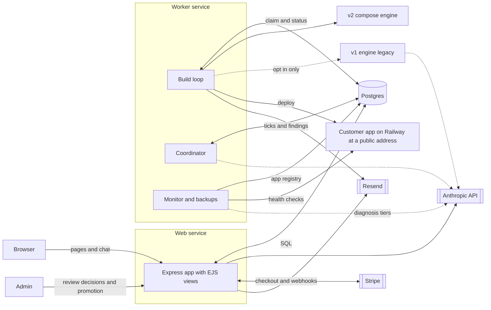
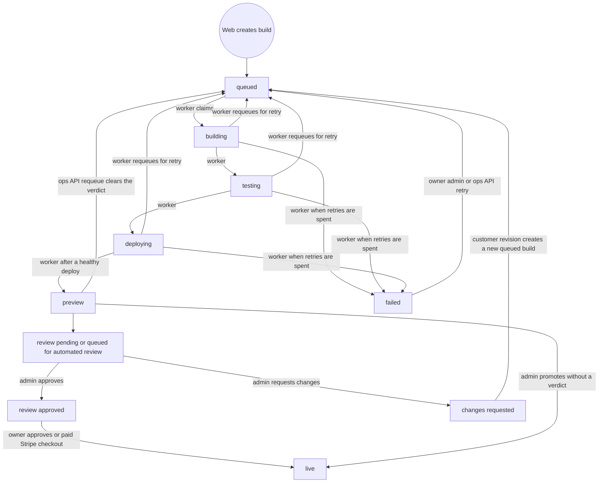

# Architecture

Craft & Ship ("CAS") was a Postgres-backed platform that turned a conversation into a deployed website. A visitor talked to an AI companion in an Express and EJS web app. A model extracted a structured spec from that conversation. Deterministic code translated the spec into a build request. A worker process claimed the request from a Postgres table, composed a small Express, EJS and Postgres application from curated JSON decision files and EJS widgets (the v2 engine; no LLM call in the build path) and deployed it to its own Railway project. The worker process also hosts a health monitor, a daily backup thread, and either a budget-gated coordinator or an older ops agent. The system ran in production from March 2026. It is no longer developed and the site is still online. This repository is an archived reference, and the code the site runs may differ from it.

Three words used throughout mean less than they suggest: **preview** and **live** are statuses in the platform's database, not places (a preview is a public, crawlable site from its first deploy, and marking a build live changes nothing on it), and **review** is a verdict recorded on the build row, by a person by design and later also by an automated mode whose loop is not in this repository. [SECURITY.md](SECURITY.md#preview-review-and-live) has the full definitions.

This document describes what the code does and links to the files that do it. Code outranks prose: where an older document under [docs/](docs/README.md) disagrees with a file linked here, the file is right.

Codenames used in the code: **Harbor** is the subscription product surface, **Haven** is the companion persona, a **keeper** is a customer, **MW** or Medicine Waves is the founder's own event brand (the canonical test site), **v1** is [cli/](cli/README.md) (the model writes the app and 117 post-processors repair it; frozen), **v2** is [compose/](compose/build.py) (deterministic compose; the default engine). Two names that can mislead: **lighthouse** (`/lighthouse`, `lighthouse.ts`) is the product's route name for the Harbor pages, not Google Lighthouse; and the coordinator's **agents**, which carry engineering job titles, are mostly rule-based checks. Three call sites in that package call a model (a support-answer draft, failure triage and the failure-KB sync); see [Coordinator](#coordinator-coordinator). [docs/GLOSSARY.md](docs/GLOSSARY.md) has the rest of the vocabulary.

## Repository map

| Path | Role |
|---|---|
| [web/](web/src/app.ts) | Customer site, Harbor companion, admin, ops API (TypeScript, Express, EJS, Postgres) |
| [queue/](queue/worker_pg.py) | Build worker, build-lifecycle mailer, deploy watchdog probe (Python) |
| [compose/](compose/build.py) | v2 engine: decision files, widgets, emitters, intake translator |
| [cli/](cli/README.md) | v1 engine, plus Railway deploy helpers the worker still uses |
| [coordinator/](coordinator/tick.py) | Tick loop, scoring, budget, permission-gated agents, roadmap file |
| [monitor/](monitor/ping.py) and [ops/](ops/agent.py) | Health checks, diagnosis, backups; the earlier self-healing agent |
| [scripts/](scripts/cas-roadmap-loop.sh) | Push and deploy helpers, lint checks run by the hooks, the roadmap executor |
| [tests/](tests/README.md), [compose/tests/](compose/tests/test_widgets.py), [web/tests/](web/tests/unit/app.security.test.ts) | Python tests, v2 engine tests, web unit and UI tests |
| [docs/](docs/README.md) | Design notes, runbooks, audits and plans; mostly dated snapshots |

## System overview



- All shared state is in Postgres. The web app and the worker do not call each other during a build: the worker reads and writes the `builds` and `build_logs` rows, and the web app reads them to render status pages. The route `POST /webhooks/build-status` exists in [web/src/routes/webhooks.ts](web/src/routes/webhooks.ts), but no non-test code in this repository calls it.
- The worker sends its own lifecycle email through [queue/mailer.py](queue/mailer.py) (Resend over HTTPS). The web app sends its mail through `sendEmail()` in [web/src/services/email.ts](web/src/services/email.ts), which writes every attempt to `email_log`. The contact form is the exception: it posts to Resend directly and writes no row.
- Dotted edges are optional or conditional: v1 runs only when `CAS_BUILD_ENGINE=v1`, and the coordinator and monitor make a small number of model calls (see their sections).
- Each customer app gets its own Railway project, service and Postgres, created by `deploy()` in [cli/deploy.py](cli/deploy.py). Customer apps do not share a database with the platform or with each other.
- After the deploy the platform reaches a deployed app through health checks, daily backups and the monitor's allowlisted restart or redeploy of its Railway service. Review decisions, promotion and subscription events are rows in the platform database; none of them reaches the app.

## Build lifecycle



`builds.status` is constrained in [web/src/db/schema.sql](web/src/db/schema.sql) to `intake`, `payment_pending`, `queued`, `building`, `testing`, `deploying`, `preview`, `live`, `failed` and `abandoned`. `intake`, `payment_pending` and `abandoned` belong to the earlier chat-intake flow and the web app's abandon check, and are not drawn. Not drawn either: orphan recovery (a row left in `building`, `testing` or `deploying` by a dead worker goes back to `queued` or to `failed`), the supervisor's outcomes, and the web statements that can fail a build (the admin kill, the ops API, and account deletion for the account's queued builds).

- **The worker has no statement that writes `live`.** In [queue/worker_pg.py](queue/worker_pg.py), `_set_status` writes only the three pipeline stages and raises `ValueError` for anything else. `_set_preview_status` writes `preview`, `_fail_build` writes `failed`, and `_requeue_for_retry`, the supervisor and orphan recovery write `queued`.
- **Worker status writes are guarded twice.** Each is one `UPDATE` that matches only a build still in `building`, `testing` or `deploying` (for `_set_status`, only the same stage or an earlier one) and only the attempt that is writing: the claim sets `builds.started_at`, hands it to the build thread as the attempt token, and every requeue clears it. The token is required (`_attempt_param` raises without one). A late or duplicate write therefore cannot move a build backwards, touch one that has been previewed, failed, killed or published, or act on a later attempt of the same build. The guard covers the status writes and the Railway columns, which the preview write sets in the same statement; log rows, screenshots, the stored artifact and cost are keyed by build id.
- **A stage write that matches no row stops the pipeline.** `_advance_stage` raises `BuildNoLongerOwnedError`, so a build an admin killed is not deployed, and a preview write that matched no row is not announced.
- **Two web routes write `live`, in three statements.** `POST /builds/:buildId/approve` in [builds.ts](web/src/routes/builds.ts) (one statement for the owner, one for the admin) and the Stripe subscription-checkout handler in [webhooks.ts](web/src/routes/webhooks.ts). Each is one `UPDATE ... WHERE status = 'preview'` with its conditions in the same statement; see [Human review gate](#human-review-gate). The optional `build-status` webhook cannot write `live`: it rejects that status, and its other writes are guarded by the build's current status.
- `testing` means different things per engine. For v2 it is a deterministic output lint ([`_lint_v2_build_output`](queue/worker_pg.py)) whose failures are logged but do not fail the build; for v1 it is an install, test and fix loop.

## Web app

[web/src/server.ts](web/src/server.ts) starts the process in this order:

1. Import [instrument.ts](web/src/instrument.ts) (Sentry).
2. Apply the schema, retrying with backoff while Postgres is unreachable, then clear the cached support answers if the knowledge hash changed.
3. Bind the port (`listenOn` in [utils/listen.ts](web/src/utils/listen.ts)). A port that is already in use is one log line and exit 1.
4. Start the abandon check, the email scheduler and, when `CAS_HARBOR_ENABLED=true`, the weekly Harbor sweeps. They do not start under `NODE_ENV=test`. A sweep is checked 60 seconds after boot and then hourly, and runs only when its claim in `platform_metadata` shows a week since the last one ([harbor-cron-scheduler.ts](web/src/services/harbor-cron-scheduler.ts)).

On SIGTERM it stops accepting connections, clears the timers and drains the pool, with a forced exit after a timeout. [web/src/app.ts](web/src/app.ts) builds the Express app without binding a port, which is how the tests drive it with supertest.

Request path, in the order `app.ts` installs it:

1. **Session secret.** Resolved before anything signs with it ([`resolveSessionSecret`](web/src/middleware/auth.ts)); outside `development` and `test` a weak or stand-in value stops the boot. The rule is in [docs/THREAT_MODEL.md](docs/THREAT_MODEL.md#controls-by-area) under "Session secret and boot refusal".
2. **Security headers and CSP nonce.** The first middleware, ahead of the optional gate; it reads nothing from the request and sets no cookie, so pages, files under `web/public`, the password challenge and the error pages that body parsing produces all carry the headers.
3. **Optional gate and body parsing.** `PREVIEW_PASSWORD` turns on HTTP basic auth for everything except a list of public paths, `/try`, `/ops/api`, `/webhooks` and files that exist under `web/public` (`isPublicStaticAsset`). The Stripe webhook receives the raw body; the Resend webhook keeps the raw bytes for signature verification; other bodies are JSON or urlencoded with a 1 MB limit, except the account forms (`AUTH_FORM_PATHS`), which have a 10 KB limit set ahead of those parsers.
4. **Crisis first.** When Harbor is enabled, `crisisFirst` from [lighthouse.ts](web/src/routes/lighthouse.ts) is mounted on `POST /lighthouse/table/turn` here, ahead of the session middleware (see the next section).
5. **Sessions.** `express-session` with the Postgres table `user_sessions` as store (memory store under `NODE_ENV=test`), then `enforceSessionLifetime` and the EJS layout middleware.
6. **Static files.** `express.static` serves `web/public`. It answers only GET and HEAD and passes every other method on, so a write aimed at a file path still meets the guard below.
7. **Same-origin CORS.** A preflight carrying an `Origin` header gets a bare 204, and any `Access-Control-Allow-Origin` header set downstream is stripped before headers flush, so a stray `cors()` added for one route cannot widen the policy.
8. **CSRF layer 1.** `rejectCrossOriginWrites` refuses writes that the browser labels as coming from another origin.
9. **View locals.** CSRF token, auth state, layout choice (the Harbor layout except under a short list of operator and API prefixes), canonical path and JSON-LD defaults. Outside `NODE_ENV=test`, a fire-and-forget page-view insert for GET pages follows, at most 30 a minute per client address and 600 a minute overall (`PAGE_VIEWS_PER_ADDRESS_PER_MINUTE`, `PAGE_VIEWS_PER_MINUTE` in `app.ts`, counted in process memory); past a cap the page is served and the view is not recorded.
10. **Routers**, mounted in this order: [auth](web/src/routes/auth.ts) (signup, email verification, login, password reset), [intake](web/src/routes/intake.ts) and [anon-intake](web/src/routes/anon-intake.ts) (the pre-Harbor chat intake and `/try`), [builds](web/src/routes/builds.ts) (dashboard, status, retry, approve, revisions, rebuild, source download), [webhooks](web/src/routes/webhooks.ts), [admin](web/src/routes/admin.ts), [support](web/src/routes/support.ts), [features](web/src/routes/features.ts), [gallery](web/src/routes/gallery.ts), [ops-api](web/src/routes/ops-api.ts), [feedback](web/src/routes/feedback.ts), and [lighthouse](web/src/routes/lighthouse.ts), which is mounted only when `CAS_HARBOR_ENABLED=true`. When that flag is on, `/try` and `/intake` redirect into the Haven conversation. The routes defined on `app` itself follow (`robots.txt`, `sitemap.xml` with its per-page dates computed in the background at boot, `llms.txt`, the marketing pages, the contact form and `/health`), then the 404 handler.
11. **Per-route controls.** `validateCsrfToken` (an HMAC token bound to the session the page was rendered in, the second CSRF layer; rendering a page stores the session so the token has one to belong to), rate limiters on `express-rate-limit` with its in-memory store, and `isAdminSession`, the one definition of admin. What each of the controls in this list accepts and refuses (cookie flags, the CSP, the two CSRF layers, the limits, who is admin) is in [docs/THREAT_MODEL.md](docs/THREAT_MODEL.md#controls-by-area).
12. **Errors.** `forwardAsyncErrors` wraps every router because Express 4 ignores the promise a handler returns; 4xx errors raised by middleware render without being logged as faults; error text reaches the client only in development and test. Most pages for refused requests (4xx) are rendered by `renderErrorPage` in [error-page.ts](web/src/utils/error-page.ts), which prints the status the response is sent with (the CSRF and not-found pages have views of their own); the `500` view is for server faults. An `unhandledRejection` handler in `server.ts` logs and reports instead of letting Node exit. Whether a refusal is JSON or a page is one rule, `isJsonRequest` in [json-request.ts](web/src/utils/json-request.ts), shared by the token check, the model limiter, the 404 handler and the error handler. The web process has one event loop, shared with the crisis handler, so nothing on a request path may block it: the dates in `/sitemap.xml` are computed once in the background after boot (git with a 3 second deadline per file, then file modification time), the route never runs a child process, the pattern that removes credentials from worker text shown to a customer is linear, the contact form's send has a 15 second deadline and Stripe calls 20 seconds with one retry.

The service-to-service surface is [ops-api.ts](web/src/routes/ops-api.ts): bearer-authenticated by `OPS_API_KEY`, admin-equivalent for the queue (requeue, rebuild, fail, delete, move a build past payment), and answering 503 when the key is unset. It has no route that writes `live`.

Postgres TLS is chosen from the parsed database URL (`poolSslOption` in [db/tls.ts](web/src/db/tls.ts)): none for loopback, Unix sockets and `*.railway.internal`; TLS without certificate verification for any other host unless `NODE_ENV` is exactly `development` or `test` (unset and `staging` get TLS); none in those two.

## Harbor companion turn

What a request to `POST /lighthouse/table/turn` meets, in order:

1. **The security headers, the optional `PREVIEW_PASSWORD` gate and the body parsers** (a body over 1 MB or malformed JSON is refused there).
2. **`crisisFirst`** ([lighthouse.ts](web/src/routes/lighthouse.ts)). A POST that passes the same cross-origin check as the global guard, and whose text matches the crisis scan ([crisis_detection.ts](web/src/companion/crisis_detection.ts), the first 20,000 characters) is answered here with a fixed script and HTTP 200. How often the scan recognizes a disclosure is a separate question from where it runs; its measured recall and known misses are in [KNOWN_LIMITATIONS.md](docs/KNOWN_LIMITATIONS.md#harbor-companion). The answer depends on the request body and a regex scan: no session, cookie, database or model is read first. After the response is written, the sender is identified from the trial cookie, the turn is stored and the operator is told by log line and email; the stored turns and the emails are bounded (`crisisSideEffects` in [runtime.ts](web/src/companion/runtime.ts)) because this path is not rate limited. Every other request passes through.
3. **Session middleware and origin guard**, then the trial-cookie middleware ([trial-cookie.ts](web/src/middleware/trial-cookie.ts)), which loads or mints the trial and answers 429 at the per-address mint cap.
4. **Two rate limiters**: per address, then per trial.
5. **The handler**: a 4,000 character limit, then the email gate (402 until an email is given, from turn 22 by default; the browser that paid for the trial's website is exempt), then `turn()`.

The order inside `turn()` in [runtime.ts](web/src/companion/runtime.ts):

1. **Crisis scan again**, so `turn()` stays crisis-first for any other caller. A hit returns the fixed script even if the identity lookup, the insert or the alert email fails.
2. **Identity**: load the trial (cookie-identified) or the keeper.
3. **Cost caps**: the last 24 hours of `companion_cost_log` for this identity and for everyone. Over either cap, `CompanionDailyCostCapError` is thrown before any model work (the route answers 429). The sum query fails open: a database error does not turn away a real keeper.
4. **Input rail** ([ai_honesty_rail.ts](web/src/companion/ai_honesty_rail.ts)): regex flags for impersonation, role-play, therapy and similar asks produce a fixed refusal template instead of a model call.
5. **Memory retrieval** ([memory_retrieval.ts](web/src/companion/memory_retrieval.ts)), then **prompt assembly** (a cacheable persona block and a per-keeper block) and the **model call** ([claude.ts](web/src/companion/claude.ts), prompt caching, a 60 second timeout, one retry).
6. **Output rail**: a `dangerous` flag replaces the whole reply with a template; a `hygiene` flag is sanitized in place.
7. **Persist** the turn, start **memory capture** in the background (a failure is logged, never surfaced), write the cost row, touch `last_seen_at`. The last two are best effort once the turn is stored, because an error there would invite a retry and a second paid call.

There is no surrounding transaction; each step is its own autocommit statement. The cost cap is checked before the call and written after it, so concurrent requests can overshoot by about one turn each; the file documents this next to the cap.

## From conversation to build request

1. The conversation lives in `companion_turns`; classified facts live in `keeper_memory` (partitions `working`, `sacred`, `voice`).
2. `extractSpecFromConversation` ([spec_extraction.ts](web/src/services/spec_extraction.ts)) reads recent turns and memory through a SQL filter that drops crisis-flagged turns and turns the classifier filed as sacred, then makes one structured-output call to the strongest model tier and shape-checks the result. The route's readiness floor and the page's build button count the same turns the extraction may read (`conversationBuildReadiness`), so a conversation of crisis messages only is told it is not ready (409), not sent to a 500. The file calls the sacred-content filter defence in depth: classification runs in the background, so a turn that is sacred in substance but not yet classified can still be included.
3. `translateExtractedSpecToV1` ([harbor_to_compose.ts](web/src/services/harbor_to_compose.ts)) is pure TypeScript with no model call, clock or random id. It emits a v1-shape spec (seed settings, data models, custom pages) plus `_harbor_meta` (archetype hint, services, testimonials, design hints). Unknown sections and nameless models are dropped with warnings rather than failing, and so is whatever the engine would refuse (a protected page at a route something else serves without a login, a public form into a model visitors can read, a model on another model's table, an unusable role name): the translator resolves each toward less exposure, with a warning, and [test_translator_output_builds.py](compose/tests/test_translator_output_builds.py) runs its real output through the engine. The header explains why v1 shape is the target: the worker already translates it.
4. `dispatchHarborTrialBuild` ([harbor_dispatch.ts](web/src/services/harbor_dispatch.ts)) is idempotent per trial. For self-serve it refuses a content-free spec and refuses to attach a build to an account whose address was verified (a typed email proves nothing, unless the visitor is logged in as that account). An anonymous dispatch (the visitor's, and the operator's of a captured address) refuses any address that already has an account, before the extraction, and creates its account row inside the insert transaction with `INSERT ... ON CONFLICT DO NOTHING RETURNING`, so an account that appears during the extraction is refused there (`builds.owner_created_by_dispatch` records that the dispatch created the owner, which the payment checks); a logged-in visitor's dispatch upserts the row for the account's own address. A dispatch is a build start like a retry or a rebuild: it is refused at the customer's build-start limits (`build_limit`, a 429 from the route) and writes a `build_start_events` row of kind `dispatch`, under the same per-customer lock ([build-start-limits.ts](web/src/services/build-start-limits.ts)). The visitor's, the keeper's and the operator's dispatch answer a failed extraction from one table, `dispatchFailureResponse` (nothing to read is 409, a failed call or a reply that is not a spec is 502), and the operator's route runs the extraction before it writes the customers row. The refusals that need no model (a verified account, any existing account for an anonymous dispatch, a limit already reached, the anonymous share of the model-call budget) are decided before the extraction is paid for; the account and limit checks are repeated after it, the limit under the lock and the verified check under a share lock on the customer row. One transaction then takes the customer's build-start lock, locks the trial row with `FOR UPDATE`, for an anonymous dispatch creates the customer row, inserts the `builds` row as `queued` through `insertHarborBuild` (which sets `builds.is_harbor`, the fact the publish rule reads), stamps `handoff_build_id` and `handoff_at` and writes the ledger row. `handoff_at` outlives the build and is what limits a conversation to one build without an operator. `dispatchHarborKeeperBuild` in the same file serves a promoted keeper through the same steps. The operator route in [admin.ts](web/src/routes/admin.ts) dispatches through `dispatchHarborTrialBuild` (`source: 'admin'`, `allowRedispatch`, `skipStartLimits`), as an anonymous dispatch for an address the trial captured and into the operator's own account only when it captured none.
5. In the worker, `translate_v1_spec` ([compose/intake.py](compose/intake.py)) maps that spec onto a v2 spec: archetype (the hint wins when valid), palette, font pair, template family and layout variants.

## Queue worker

[queue/worker_pg.py](queue/worker_pg.py) is one process, started by the `CMD` in [Dockerfile.worker](Dockerfile.worker). It does not apply the platform schema; it relies on the web service having done so.

**Claim.** The loop claims only when one of its build threads is free (`_claim_and_dispatch`): the status count below is the limit across workers, and the free-thread check keeps a claimed build from waiting in the pool's queue while an earlier build's thread is still sending email or cleaning up. `_claim_next_job` then does the following in one transaction:

- takes a transaction-scoped advisory lock (`pg_try_advisory_xact_lock`), which is what prevents two workers from both seeing "no active builds";
- checks the count of builds in a pipeline status against `MAX_CONCURRENT_BUILDS` (default 1);
- checks the recorded model spend of builds worked on today (`COALESCE(started_at, updated_at) >= CURRENT_DATE`, so a build waiting for a retry still counts) against `DAILY_API_SPEND_CAP` (default 50 USD), failing closed if the query fails. Only the v1 engine records spend; under v2 the figure is 0 and the cap never triggers;
- selects the oldest queued build with `FOR UPDATE OF b SKIP LOCKED` (`builds.tier` does not affect the order), flips it to `building`, records `build_engine` and returns `started_at` as the attempt token.

The claimed attempt is added to `_OWN_ATTEMPTS` and leased, under a key made of the build id and its `started_at`, on the claiming thread before it is handed to the pool.

**Run.** Each claimed build runs in a thread pool slot, wrapped by a supervisor that gives the pipeline the tier timeout (60, 90 or 120 minutes; 25 for an unrecognized tier) plus 30 seconds. On expiry `_supervisor_force_fail` fires the attempt's cancel event, reads the row, and probes Railway ([watchdog_probe.py](queue/watchdog_probe.py)) with no lock or transaction held, because a thread stuck in a C-level call can have finished the deploy. Each attempt registers its own cancel key and hands it to the v1 fix loops and the model client, which stop at their next checkpoint; a thread blocked in the Railway CLI or a socket is not interrupted, and the v2 pipeline has no checkpoints. Then the supervisor writes one guarded outcome:

- a deployment that answers `/health` goes to `preview`, with the probed project recorded in the same statement, and is announced like any other preview;
- a first hang with retries left is requeued, once per build (`supervisor_retry_used`);
- a second hang, or no retries left, fails through `_fail_build`.

**Leases.** The claiming thread takes a session-level advisory lock for the build on a dedicated connection and hands it to the build thread, which releases it when it has finished everything, including what it does after the row left the pipeline statuses. Orphan recovery (at startup and every 120 seconds) treats a `building`, `testing` or `deploying` row as dead only if `pg_locks` shows no holder, this process does not own it, and it started more than 30 seconds ago. The lease is best effort: if it cannot be taken the build runs anyway, and nothing re-checks it mid-build.

**Recovery.** For each orphan, `_recover_orphaned_builds` decides in this order:

- the supervisor already spent its free retry: fail;
- the build's files are on disk and it was interrupted in `testing` or `deploying`: requeue with a resume marker, without using a retry, at most `_MAX_ARTIFACT_RESUMES` (5) times;
- otherwise requeue using a retry (`_MAX_RETRIES`, 6, the same counter as every other requeue), or fail when none is left.

At the next claim `_resume_stage` resumes from the marker, or from `builds.build_artifact` (a compressed copy of the build directory kept in Postgres) when the row has one, and otherwise starts over. The marker is the whole value of `builds.error_message`, in an exact format that the worker and the ops API's requeue-from-stage route both write (`_parse_resume_marker`). A build requeued in place by the web app keeps its artifact when it has one, so it is redeployed from the stored files without being rebuilt.

**Retries.** A pipeline error is requeued up to 6 times within a 2-hour budget measured from the first attempt of the current series of retries, on a clock kept in the worker process (a restart starts it again). The exceptions:

- a non-transient error clears the stored artifact and rebuilds from scratch;
- infrastructure-looking errors (npm failure, disk or memory exhaustion) and design-gate failures get one retry, QA-gate failures none;
- the same non-transient error twice in a row stops the retries;
- a deterministic failure is not retried, because the same input produces the same output: a failure tagged `[v2-deterministic]`, or a spec the engine refused ("Spec validation failed", `_is_deterministic_failure`).

**Terminal failure.** `_fail_build` is the only way the worker sets `failed`: the pipeline's last error, the supervisor's terminal timeout, the permanent failures of orphan recovery and a crash of the build thread all go through it. In one transaction it inserts a `dead_letter_builds` row and flips the status (`_MARK_FAILED_SQL`); if that transaction errors, the flip is retried alone. Only when the flip matched does it email the customer and run the janitor. It does not touch Railway.

**Railway projects.** `builds.railway_project_id` is written by the preview write, so it names a deployment that reached preview. The project an attempt creates is held in the attempt's own state and deleted by that attempt (`_discard_unannounced_project`) when the attempt ends any other way: a retry, a terminal failure, a kill during the deploy, a crash of the thread, or the thread finishing after the supervisor gave up on it. A thread the supervisor gave up on cleans up on a connection of its own (`_discard_after_abandonment`: the connection it started with was closed when `_process_job` returned; connecting takes about 48 seconds at most). `_discard_unannounced_project` refuses when any build row records the project, when a preview write announced it for this attempt, when that lookup fails, or without a token. The supervisor's preview write for a project its probe found (`_write_probed_preview`) and the thread's look-up and delete hold the same lock, so a project is announced or deleted, not both; the supervisor waits at most 240 seconds for it. A project that a preview write announced for the attempt, including one the probe found while the thread was still inside `deploy()`, is not deleted by this clean-up. The janitor (`_cleanup_old_builds`) deletes rows only: failed or abandoned builds beyond the two newest of the same customer and app that have no surviving descendant, no hand-off stamp, no recorded Railway project and were never published. [docs/KNOWN_LIMITATIONS.md](docs/KNOWN_LIMITATIONS.md) lists what this leaves behind (a project whose worker was killed mid-attempt, a preview superseded by a later deployment of the same row).

**Stages.** Validate, build, test, deploy. Deploy creates a Railway project, a service and a Postgres, sets variables, uploads the source with the Railway CLI, waits for the deployment and checks `/health`. For v2, `deploy()` skips the v1 password-login probe, and if it still reports the app unhealthy the worker re-probes `/health` once with a 180 second budget, because Railway often reports a crash during the post-migration restart and then settles. A healthy answer is HTTP 200 with a JSON body whose `status` is `ok` (`health_response_ok`); a generated site answers 503 `home_page_error` when its own home page did not render when it started, which is not healthy (`services/health.js`). A deployed app that never answers `/health` healthy ends the attempt as a transient failure and is retried; it is not previewed, and no fix loop runs for it on either engine. `deploy()` also returns Railway's end state for the deployment: a FAILED deployment is retried once, a CRASHED one whose log shows the database unreachable is transient, and any other crash of a v2 app is final (`_v2_deploy_failure`). After a healthy `/health` the worker signs in once with its own verification token by POST (`verify_magic_link_auth`), which uses that token up. With no `RAILWAY_API_TOKEN` the deploy is skipped and the build is recorded as `preview` with no address and no email.

**Announcement.** When the preview write lands, `_announce_preview` registers the app with the monitor, emails the admin that a review is needed (not under `CAS_HARBOR_AUTO_REVIEW`), runs the janitor, and emails the customer the address and a login link for the site's admin (`send_preview_ready`). Every step is best effort: the build is already at `preview`. The supervisor's recovered previews go through the same function.

**Side threads.** `run_worker` also starts the health monitor, the daily backup thread (03:00 UTC), and either the coordinator (`COORDINATOR_ENABLED`) or the legacy [ops/](ops/agent.py) agent. SIGTERM only sets a flag. Railway sends SIGKILL after `drainingSeconds` (60, see [railway.toml](railway.toml)), shorter than a build, so an in-flight build is cut off and recovered by the next process.

## v2 engine (compose/)

[compose/build.py](compose/build.py) takes a structured spec and emits a complete Express, EJS and Postgres application. The module docstring is the best summary of its guarantees; the path through it is:

1. **Decision files** in [compose/data/](compose/data/archetypes.json): archetypes (which pages, models and defaults a kind of business gets), palettes, font pairs, page layouts, template families, flourish sets, field types and a widget registry. Adding an option is a JSON edit, not code.
2. **Widgets** in [compose/widgets/](compose/widgets/): EJS partials grouped as admin, auth, content, cta, error, form, hero, offerings, shell, testimonials and utility. [compose/tests/](compose/tests/test_widgets.py) renders them with Node's EJS.
3. **`validate_spec`, then `resolve_spec`.** Both run `_spec_safety_errors`, the gate for spec strings that become an identifier, SQL column type, mount path or file name. `resolve_spec` also refuses a spec whose `auth_required` page has a path that something else in the build would answer without a login (`_auth_required_page_errors`), and a spec whose public form stores into a model that is shown to visitors and has no boolean `published` column (`_public_form_errors`). Other unusable custom page paths are dropped, once, by `_classify_custom_pages`, and routes, views, sitemap and navigation all use the survivors. `validate_spec` reports those refusals too (when the gate finds nothing it runs `resolve_spec` on a copy), and the ones they found: page data that does not fit the parameters its widget declares (`_page_data_errors`), a column the engine reads with a fixed meaning that has a type it cannot work with (`_engine_column_type_errors` in the gate; `_engine_column_errors` for the link to a parent and the newsletter email), models that belong to each other in a ring (`_models_in_creation_order`), a public form page that names no column a visitor may fill in (`_public_form_field_errors`) and a spec that names a stock photo of a specific person or place (`_personal_stock_photo_errors`). A page that lists `allowed_roles` is a protected page whether or not it says `auth_required` (`_roles_imply_login`: `resolve_spec` sets the flag and records `allowed_roles_imply_login`). Before any of that, `build_app` bounds the whole decoded document, unknown keys included (`_document_size_errors`), and the gate bounds the containers (`_spec_size_errors`) and gives each key the emitters read one accepted JSON type (`_kind_problem`), so a spec it accepts is one the emitters can read; [test_spec_shape_matrix.py](compose/tests/test_spec_shape_matrix.py) puts every JSON type, and two valid column types, at every position of ten sample specs and requires a refusal or a site whose every page renders (on a real PostgreSQL when one can be reached). What the gate refuses is listed in [docs/THREAT_MODEL.md](docs/THREAT_MODEL.md#controls-by-area) under "Build engine".
4. **Escaping.** Spec text is treated as hostile: it is escaped per output context (`_sql_esc`, `_js_escape`, `_ejs_json`, `_html_attr`) and link targets are normalized by `_sanitize_spec_content`. The public layout's JSON-LD is escaped in its template instead: `<`, `>`, U+2028 and U+2029 become backslash-u escapes ([layout-public.ejs](compose/templates/layout-public.ejs)). Resolution picks palette and fonts (archetype defaults if unset) and a layout variant per page.
5. **`compose_files`** returns `(path, content)` pairs for the whole app: `package.json`, schema and seed SQL, `server.js`, middleware (auth, CSRF, rate limit, a log helper that drops query strings), `services/health.js` (the home-page check behind `/health`: the site answers 503 `home_page_error` when its home page did not render at boot), routes (auth, admin, upload, legal, SEO, pages, one per data model), views, widget copies, CSS and brand assets, plus an Open Graph image drawn with Pillow. SQL that depends on a model (the contact form's insert, a listing's order) is derived from that model's own fields. Tables are created parent first (`_models_in_creation_order`, used by the schema, the seed and the dashboard's clearing), "published" has one definition (`_published_condition`: the flag is TRUE, and a row whose flag has no value is not published, on every public read), and a visitor can sort a public list only by a column it prints (`_public_sort_columns`).
6. **`_write_build_files` writes them.** `build_app` first removes an existing output directory, and only one it recognizes as an earlier build (`_remove_previous_build`). Every path goes through `_safe_output_path`, which keeps writes inside the build directory, and the list is refused if two files share a path. `build_app` then writes `compose-manifest.txt` (archetype, palette, font pair, tier, file count, a SHA-256 over sorted paths and contents, the warning counts, the state of the external-URL lint (`external_url_lint: skipped`, `ran` or `failed`) and one line per warning: the engine's `warning: ` lines first, then the `spec-warning: ` lines the spec carried) and, when there are warnings, `translation-warnings.txt`. The shape is stated once, in [V2_ENGINE_BEHAVIOR.md](docs/internals/V2_ENGINE_BEHAVIOR.md).

**What a build publishes.** A model's rows are served without a login only where the spec sets `public_listing_path` on the model or a page layout of the archetype reads its table (`_public_row_sources` is the one definition); nothing is published because of a name, so a custom page whose path is a model's name is an ordinary page, the model stays admin-only and the build report carries `page_named_like_model`. A row created through a public form (a custom form page, the contact form, the newsletter signup) is stored with `published = FALSE` when the model has a boolean `published` column (a column typed `boolean` or `bool`; a column of that name with another type is an ordinary column, `_publication_column`), a row whose flag has no value is not published, and the submitted values are validated against the model before the insert. A public form page lists the columns a visitor may fill in (`allowed_fields`) or the spec is refused, and the form, its handler and the INSERT use that list and no other column.

What "deterministic" means here: the emitted app is a function of the spec and of the files in this repository, with four exceptions and no others (the module docstring of `compose/build.py` lists them). On one machine, with the first two pinned and the fourth switched off, the same spec produces the same bytes ([test_spec_hardening.py](compose/tests/test_spec_hardening.py) builds one spec in two interpreters with different hash seeds and compares every file).

1. **The build time** is the one wall-clock input (`_build_moment`). It becomes the sitemap `lastmod`.
2. **The build day** dates the "upcoming" sample events (`_sample_date`, used in `compose/build.py` and by `scaffold_spec` in [compose/intake.py](compose/intake.py)). Setting `SOURCE_DATE_EPOCH` pins (1) and (2); without it two builds of one spec on different days differ in those values.
3. **The raster brand assets** (the favicon family and `og-default.jpg`) are emitted only when Pillow is installed and are drawn with whichever system font it finds first. Nothing pins them, and how much they differ between machines has not been measured.
4. **The external-URL lint** is run by `build_app`, not by `compose_files`. Unless `CAS_LINT_EXTERNAL_URLS=skip`, [lint_external_urls.py](compose/lint_external_urls.py) sends a request to each external URL in the spec (with SSRF guards on every connection and every redirect target) and writes a `warning: ` line for each dead one into `compose-manifest.txt` and `translation-warnings.txt`, so those two report files depend on the network at build time; with `error` a dead link refuses the build. No emitted app file, and not the manifest's `sha256` line, depends on it. The walk over the spec is iterative, and the manifest's `external_url_lint:` line says what became of the lint: `skipped` (`lint_mode()` is `skip`), `ran` or `failed` (the lint itself raised, so no URL was judged; the warning `external_url_lint_error` says why). The determinism test pins (1) and (2) and sets the lint to `skip`.

"No LLM in the build path" is therefore not "no network": item 4 is the network.

What the engine does not do:

- **It emits one site, with no notion of preview.** The generated `server.js` reads no setting that tells a preview from a live site. `emit_routes_seo_js` serves `/robots.txt` with `Allow: /` and a `/sitemap.xml` of the public pages, and [layout-public.ejs](compose/templates/layout-public.ejs) marks every public page `index, follow`.
- **It does not read `rebuild_request`.** A customer revision and a reviewer's change request reach the worker as text in `builds.rebuild_request` on a new build that carries the same spec; only the v1 engine reads that text, so under v2 the rebuilt site is composed from the unchanged spec.

For v2 the worker skips design review, QA fix, UI tests, the deploy-fix loop and the v1 route, auth and data checks. A crash after deploy fails fast instead of invoking a v1 fixer, because those fixers rewrite files in ways that break v2 output.

## v1 engine (cli/)

[cli/README.md](cli/README.md) is the map. [cli/build.py](cli/build.py) prompts Claude to write the app from the spec in several passes, then runs the `@processor` functions registered in [cli/pipeline.py](cli/pipeline.py). That module orders them as a DAG from declared `after`, `before`, `produces` and `consumes` metadata (a topological sort with alphabetical tie-breaking, plus a parity check that every consumed artifact has a producer). Around it sit model-driven review, QA, design-review and fix loops, and a failure knowledge base fed back into prompts.

It was replaced because of how it failed. A model that writes the app differently each time, plus code that repairs the difference, produced recurring regressions that each fix could re-open; [MW_BUG_RECURRENCE_RCA.md](docs/internals/MW_BUG_RECURRENCE_RCA.md) groups them (convention drift, contract mismatch, regex scope, ordering, fixes applied by hand and never fed back, missing pieces) and [CAS_V2_STATIC_COMPOSE_PLAN.md](docs/internals/CAS_V2_STATIC_COMPOSE_PLAN.md) records the decision to remove the model from the build path. v1 runs only when `CAS_BUILD_ENGINE=v1`; some modules (`deploy.py`, `api_client.py`, `cancellation.py`, `failure_kb.py`) are still imported by the worker.

## Human review gate

The gate was designed around a person. What the code enforces is narrower than the name: a verdict on the build row stands in front of the `live` status, and three `UPDATE` statements can write that status. The full statement of the gate (how a build enters review, the three publishing paths and what each requires, which subscription statuses publish, who cannot publish) is in [docs/THREAT_MODEL.md](docs/THREAT_MODEL.md#controls-by-area) under "Review gate and publication". How it sits in the lifecycle:

- **Entering review.** The preview write puts the build into review and clears what an earlier review recorded (`_set_preview_status`), and for a build deployed to Railway the worker then emails the admin, once per arrival, so again after every rebuild. Under `CAS_HARBOR_AUTO_REVIEW=true` the state is `ai_review_queued` (the optional status hook decides the same way) and no admin email is sent; nothing in this repository consumes that state.
- **Deciding.** `/admin/reviews` in [admin.ts](web/src/routes/admin.ts) lists builds at `preview` or `live`. Approve records the verdict and the reviewer and emails the owner once (a row lock makes a double click harmless); request-changes requires notes. Both record a verdict only on a build at `preview`, and answer any other status with a 409 page, recording nothing and sending no email.
- **Publishing.** The owner's approve route and the Stripe checkout handler carry the review condition in their `UPDATE` (and the handler applies a payment only to an account whose keeper has no subscription of its own that the payment may not replace, writes no keeper row on a verified account for a session that no login of it opened, and promotes a trial only into the account its own dispatch or the payment created, unless the account's login opened the session; a refused payment is recorded and listed on `/admin/harbor` under "Payments needing a person"); the owner's route also requires a subscription for a Harbor build (`builds.is_harbor`, set at dispatch and inherited by rebuilds and revisions through a trigger). The admin's variant of the approve route requires only `preview`.

What the gate does not cover: the deployment (the site is public at its address from the moment the deploy lands, and the customer already holds that address and a login to the site's admin), payment for builds that are not Harbor builds, anything after `live` (a subscription that ends leaves the build `live` and the site up), and taking a site down (nothing removes a deployed site because changes were requested, a revision superseded it or it was never approved). [docs/KNOWN_LIMITATIONS.md](docs/KNOWN_LIMITATIONS.md) has the precise statements.

## Coordinator (coordinator/)

[tick.py](coordinator/tick.py) `run_tick` runs every `COORDINATOR_INTERVAL_S` (default 1800) when `COORDINATOR_ENABLED` is set. Both the coordinator and the legacy ops agent default to dry run. One tick:

1. **Guard**: stop on shutdown; skip if the previous tick was too recent.
2. **Snapshot** (`build_world_state`), expire stale work, and deny approval requests nobody answered (a timeout is a "no").
3. **Budget**: `compute_tick_budget` in [budget.py](coordinator/budget.py) spreads the remaining daily budget (`COORDINATOR_DAILY_BUDGET`, default 20 USD) over the remaining ticks. Today's spend comes from one configured source: the Anthropic cost report when `ANTHROPIC_ADMIN_KEY` is set, otherwise the worker's own ledger of build and agent-task costs (`spend_tracker.get_daily_spend`), which does not include what the web tier spends on chat. If that source cannot be read the tick gets nothing: zero dollars and zero calls, with no earlier figure used in its place (`max_api_calls` is the number of whole calls the dollars pay for). Unknown is never read as zero: a cost report without a list of days, without a bucket for today, with a non-USD or non-finite amount, or with pages left unread makes today's spend unknown, a failed refresh of the world state leaves its figures unknown, and unknown pipeline counts are read as a customer build in progress. Any active customer build cuts the coordinator to one cheap-tier call. A task whose agent declares its category model-free (`model_categories` on the agent class) is still dispatched in a tick with no budget, from an allowance that is not metered; a task that may reach a model call waits, and the meter still grants no model call at zero.
4. **Detect work**: `detect_work` in [work_detection.py](coordinator/work_detection.py) runs the 17 `_check_*` triggers, every one of which it calls; [test_coordinator_routing.py](tests/test_coordinator_routing.py) fails if a trigger is defined and not called, or routes a category to an agent with no handler for it. They turn database facts (failed builds, apps down, new feedback, stale backups, recurring QA warnings) and a few daily or weekly schedules into work items, deduplicated by a partial unique index on category and context hash. One trigger acts: failure triage asks a cheap-tier model to categorize a failed build the regex classifier could not, through `Actuators`, at most five times per tick, never under dry run, and only with calls the tick's allowance grants.
5. **Score**: `score_task` in [scorer.py](coordinator/scorer.py) combines category weight, urgency, a cost penalty and a performance multiplier; the multiplier's per-agent outcome counts are read once per tick from `agent_tasks` (`build_performance_cache`).
6. **Dispatch**: skip unregistered or disabled agents and, for work below P0, a pair whose failure circuit is open (three or more live outcomes, the newest failed, 80% failed; after 6 hours one task per pair per tick is let through as a probe), pick a model from `AGENT_MODELS` (default, escalation, trigger), reserve the estimated cost, and run independent tasks in parallel batches under per-agent timeouts. No agent reports token usage, so each dispatched task is charged its estimate and one call (`_task_charge`). Separately, every model call, whichever task or step makes it, is granted one at a time by the tick's `ModelCallMeter` inside `Actuators.authorize_model_call`: a tick makes at most `max_api_calls` calls with an estimated cost of at most `max_cost_usd`, and the number granted is stored in the tick record.
7. **Record**: each task's outcome, actions and notes stay on its `agent_tasks` row and the tick is written to `coordinator_ticks`. Rows written under dry run are marked and are left out of the failure circuit and the performance counts.

**Most of the agents are rule-based Python.** Ten agents are registered in [coordinator/agents/](coordinator/agents/base.py). Their file headers say which make no model call (architect, backend, cost analyst, documentation, financial, QA, reconciliation and security). The model call sites in the package are three, all on the cheap tier: the customer-service agent's draft of a cached support answer, [build_failure_categorizer.py](coordinator/build_failure_categorizer.py) (failure triage) and [failure_kb_sync.py](coordinator/failure_kb_sync.py) (run by the infra agent, whatever tier that agent's task was dispatched on). The model tier chosen for a rule-based agent only sets the cost reserved for the task. The "agents" are scheduled handlers with a permission table, not autonomous planners.

**Permissions.** `AGENT_PERMISSIONS` in [actuators.py](coordinator/actuators.py) maps eleven principals (the ten agents and the failure-triage step) to nine named permissions, 29 (principal, permission) pairs in all: `railway_deploy` and `railway_env` (read only by `run_playbook` and held only by `infra_engineer`), `approval_request` (held by infra, security, financial, customer service and reconciliation, the principals whose real handlers escalate or file), `email_send`, `build_queue`, `build_annotate`, `model_call`, `kb_record` and `finding_write`. `qa_test` holds none. An agent's writes, sends and model calls are made through `Actuators`, which checks analysis-only mode and the permission, then dry run (the default, under which a gated method only records what it would have done). An agent cannot build its own `Actuators`: the constructor raises `PermissionError` for a caller in the `coordinator` package other than `coordinator.tick` and `coordinator.work_detection`, which is a check on first-party code, not a sandbox. The coordinator has no method or permission that approves or promotes a build, and nothing in `ops/` or `coordinator/` commits to a repository. An approval request (`create_approval_request`, which needs `approval_request` and is refused in analysis-only mode) is filed only by an agent's escalation or the reconciliation agent; it is advisory (nothing executes when one is approved) and is rejected after a timeout, 4 hours by default. Reads and the tick loop's own bookkeeping (task rows, the tick record, expiring approval requests) are outside this layer. The rules of the gate, its one dry-run exemption, the limits on live actions and the import scan that keeps effects from going around it are in [docs/THREAT_MODEL.md](docs/THREAT_MODEL.md#controls-by-area) under "Coordinator budget and permission gates". [test_coordinator_permission_use.py](tests/test_coordinator_permission_use.py) runs the real handler for each of the 29 pairs. The legacy ops agent does not go through this layer; [docs/internals/monitor-ops-scripts.md](docs/internals/monitor-ops-scripts.md) says what bounds it.

## Monitor and backups (monitor/)

- [ping.py](monitor/ping.py) health-checks every registered app (`monitor_apps`) on `MONITOR_INTERVAL`, through the URL guard and pinned session described under [Trust boundaries](#trust-boundaries), as one bounded exchange with a deadline and a cap on the decoded body ([bounded_fetch.py](monitor/bounded_fetch.py)). A failed read of the registry is retried after a backoff, and the worker restarts the loop if it ever ends. An app that does not answer in 10 consecutive check cycles is removed from the registry.
- Failures escalate to [diagnose.py](monitor/diagnose.py): tier 3 on the cheap model, tier 4 on the strongest, under a rolling 24 hour cap on model calls. Model output can only select an allowlisted fix (restart or redeploy), and a missing environment variable is alert-only. The deployment logs it reads are wrapped as data, and a model reply cannot suppress the notification: every run ends in an escalation.
- [backup.py](monitor/backup.py) runs `pg_dump` daily for each app in the registry, against the `DATABASE_URL` that Railway reports for the app's service, with files created mode 0600 in a directory per registered app. Its header states two things the repository cannot settle: the default location is lost on redeploy unless a volume is mounted, and whether the worker can reach each customer database through the private host name that `deploy()` sets is not established here. A failed dump is logged as an error. It writes each dump under a temporary name, fsyncs it, checks that it is a complete dump and only then renames it; pruning counts and deletes only complete dumps and never the newest one.
- [registry.py](monitor/registry.py) stores the app list in Postgres. Because backups iterate that registry, an app the monitor removed also stops being backed up.

## Roadmap executor (scripts/)

[scripts/cas-roadmap-loop.sh](scripts/cas-roadmap-loop.sh) is a bash loop for a developer machine (macOS launchd; the plist template and watchdog are alongside it). **It ships disabled** (`"enabled": false` in [scripts/cas-executor-config.json](scripts/cas-executor-config.json)), and nothing in the web, worker or CI path starts it. Per interval it picks an item from [coordinator/roadmap.json](coordinator/roadmap.json) and runs a headless Claude Code session in a git worktree. It starts a session only when the web app's ops API has answered with the number of builds queued or in progress and with today's spend (`preflight_check`, `active_build_count`), and the spend is under `daily_spend_ceiling_usd`; with no answer it yields. The spend counts only when the cost report is complete (`platform_costs_partial` exactly false, a finite, non-negative total), which needs `ANTHROPIC_ADMIN_KEY` on the web app: without it the report is always partial and an enabled executor starts nothing. A figure fetched earlier the same UTC day is served as complete until that day ends, so the check can pass on a day whose spend is still growing ([KNOWN_LIMITATIONS.md](docs/KNOWN_LIMITATIONS.md)). The cycle also yields while any path of the checkout is unmerged (`unmerged_paths`, `git ls-files -u`), which a stash pop that conflicted leaves behind. Then, in order:

1. **A committed change.** The worktree must be on its branch and clean, and the branch tip, read once as the tested commit, must descend from the commit the worktree was created from (recorded by hash before the session ran) and differ from it. Otherwise the run is rejected and the item stays pending. That one commit is carried through the rest.
2. **The merge guard** (`guard_report`, which lists `git diff -z --raw --no-renames --ignore-submodules=none` between those two commits and hands it to [scripts/cas-merge-guard.py](scripts/cas-merge-guard.py), so both sides of a rename, deletions and file modes are seen). It refuses any change under `scripts/`, `.githooks/`, `.github/` or `.claude/`, any change to a `CLAUDE.md` or to `coordinator/roadmap.json`, any `package.json`, lockfile or `.npmrc`, anything under a `node_modules`, the Vitest, Vite, PostCSS, Tailwind and Playwright configuration and the Vitest setup file, any `conftest.py` or pytest configuration file, top-level Python modules and top-level package `__init__.py` files, compiled Python at any depth (anything under a `__pycache__` directory, any `.pyc`, `.pyo`, `.pyd` or `.so` file), every Dockerfile and `.dockerignore`, the Railway and nixpacks configuration (`railway.toml`, `web/railway.toml`), every `requirements*.txt`, the `Makefile`, any compose file (`docker-compose.yml` and its overrides), and `web/src/db/schema.sql` with `web/src/db/migrate.ts` (`PROTECTED_PATHS` in the helper is the full list), the deletion of any file under a directory named `tests`, `test` or `__tests__`, any path the branch leaves as a symlink or a submodule link, and any path that is not valid UTF-8 or has a byte outside printable ASCII (on a filesystem that folds case and Unicode normalization such a name can be a protected file under another spelling). Paths are compared as bytes, ASCII letters without regard to case, and a listing the helper cannot read is a refusal.
3. **The tests** (`npm test` and `pytest tests compose/tests`, not Playwright), each command under a time limit, on a fresh checkout of the tested commit and not in the session's worktree, with pytest started so that nothing in the tree can stand in for the runner, its configuration or its plugins, and with every `__pycache__`, `.pyc` and `.pyo` removed from the checkout first and Python run with `-B --check-hash-based-pycs always` and `PYTHONDONTWRITEBYTECODE=1`, so bytecode the commit carries cannot run in place of its source (`run_test_gate`, `gate_remove_bytecode`, `gate_pytest`).
4. **The build check, then the merge.** Holding the merge lock, the loop asks the ops API how many builds are queued, building, testing or deploying (`wait_for_builds_clear`) and waits, up to 45 minutes, for none: its push carries the item's roadmap commit, `coordinator/**` is in the worker's `watchPatterns` ([railway.toml](railway.toml)), and a redeploy cuts off a build in any of those statuses. If the counts cannot be read three times in a row it pushes nothing. Then the guard again, a check that the branch still is the tested commit, the merge of that commit by hash, the item's `completed` mark committed as exactly that one change to `coordinator/roadmap.json` through the pre-commit hook (`record_roadmap_status`; if it cannot be committed the merge is taken back by `take_back_merge`, which acts only while the checkout is still on the target branch, only on a merge the loop can show it made, and with `git reset --keep`, so a person's uncommitted edit is kept and, where the merge changed the same file, stops the take-back; when it stops, the merge, its journal and the pre-merge stash stay, nothing is pushed, and the next cycle starts nothing until it has settled them), and the push. A second item that reaches the merge step while a journal exists does not merge. A push that does not report success is judged by asking the remote: only after the remote has said it lacks the merge is the branch taken back. A stash or merge refused because a path is unmerged is not charged to the item. With `tiered_governance` on, a diff classified high-risk skips this step: the tested commit is pushed as a draft pull request instead.

Its header lists the limits: the session runs with whatever permissions the user's Claude Code settings grant and is not sandboxed (it can write outside its worktree), so the guard and the gate bound what a branch can get merged, not what a session can do; a branch may still weaken a test it is allowed to edit; the push sends every commit on the target branch of that checkout that the remote lacks, so a commit a person or a session made there directly goes out with it; the configuration is read from the working tree at every cycle, so a session that rewrites it changes the next cycle's limits; the build check is a snapshot (a build the worker claims after the last zero count is still cut off by the redeploy); and Python tests are not re-run after the merge. It fails closed where it depends on the ops API (no answer for the build counts, or an incomplete or implausible answer for today's spend, means no session and no push), and its calls to the ops API, git and `gh`, the session and the gate's three commands have time limits (a job that runs over is ended as a process group together with its process tree). A merge interrupted by a signal or a crash is settled at the next cycle from a journal, `logs/executor/merge-in-progress`: kept if the remote has it, taken back if the remote lacks it, and nothing starts while the remote cannot be asked, or while taking it back would overwrite a person's edit or move a branch other than the target. No code in the coordinator writes `coordinator/roadmap.json`; the loop itself changes only the status, and at most one note field, of an item that is already there. Roadmap text is prompt input, so whatever a person files becomes work for an enabled executor.

## Data model

All of it is in [schema.sql](web/src/db/schema.sql): 39 tables (`grep -c 'CREATE TABLE IF NOT EXISTS' web/src/db/schema.sql`).

| Purpose | Tables |
|---|---|
| Customers and builds | `customers`, `builds`, `intake_messages`, `build_logs`, `build_start_events` (the per-customer ledger of build starts: manual retries, rebuilds, revisions and a conversation's first build), `dead_letter_builds`, `password_reset_tokens`, `email_verification_tokens`, `feature_requests`, `feature_messages`, `beta_feedback` |
| Platform plumbing | `user_sessions`, `platform_metadata`, `processed_webhooks` (event-id idempotency), `worker_heartbeat`, `page_views`, `newsletter_subscribers`, `email_log`, `email_schedule`, `support_kb` |
| Harbor companion | `trial_keepers`, `keepers`, `companion_turns`, `keeper_memory`, `companion_cost_log`, `harbor_subscriptions`, `harbor_subscription_tombstones` (subscription ids of deleted accounts, so later Stripe events can be acknowledged), `funnel_events` |
| Operations | `monitor_apps`, `ops_actions`, `coordinator_ticks`, `agent_tasks`, `agent_learnings`, `agent_performance` (read and written by nothing; kept so the schema stays a superset of existing databases), `platform_costs`, `approval_requests`, `coordinator_findings`, `executor_runs`, `executor_questions` |

`builds` carries the queue position, the engine, the review fields, spend, the artifact blob and `is_harbor` in one row (its log lines are rows in `build_logs`), which is why the web app and the worker need no other channel. `is_harbor` is set at dispatch and copied from the parent row by the trigger `builds_inherit_is_harbor`, so a rebuild or revision carries it whichever component inserts the row. `companion_turns` and `keeper_memory` each have an exactly-one-of check between `keeper_id` and `trial_id`. `harbor_subscriptions.last_event_created` holds the creation time of the newest Stripe event applied to a subscription, which is how an older event that arrives late is skipped. Embeddings are stored as `DOUBLE PRECISION[]` and compared in JavaScript; there is no pgvector.

**How the schema is applied.** `runMigration` in [migrate.ts](web/src/db/migrate.ts) reads the whole file and runs it in one transaction at every boot; `waitForDatabase` in `server.ts` retries with exponential backoff and exits if the database never answers. The file is written to be applied again and again (`CREATE TABLE IF NOT EXISTS`, `ADD COLUMN IF NOT EXISTS`, `CREATE OR REPLACE FUNCTION`, guarded `DO` blocks for constraint changes and backfills); [schema.idempotency.test.ts](web/tests/unit/schema.idempotency.test.ts) applies it twice to a real database when one is configured. The pre-commit hook runs [check_destructive_ddl.py](scripts/check_destructive_ddl.py) on the staged content, not on the working-tree file. It reads the SQL with a tokenizer, so a statement inside a `DO` block, `DROP` and `TABLE` on two lines, `ALTER TABLE t DROP col` and a block comment between keywords are all seen, and it rejects `DROP TABLE`, `DROP COLUMN`, `ALTER COLUMN ... TYPE`, `TRUNCATE` and a `DELETE FROM` with no `WHERE` or with a `WHERE` that names no column, unless a `-- SAFE: <reason>` comment is above the statement (or above the `DO`). Because the file runs at every boot it also refuses, at any depth, `UPDATE`, `INSERT INTO`, `DELETE FROM`, `MERGE INTO`, `COPY ... FROM` and an `EXECUTE` of anything but one string literal unless a `-- SAFE: <reason>` is on the statement's own line or directly above it (a reason above the `DO` block does not count for these), and it refuses, whatever the comment, any such statement that names the string `live` and any column default of `live`. The web test reads the file with its own reader, held to the same corpus of awkward inputs (`web/tests/unit/fixtures/sql-scan-corpus.json`), and lists the nine row changes the file may contain; the merge guard keeps an executor branch out of the file. Neither reader decodes strings or follows concatenation or variables. The comment satisfies the DDL hook only: the schema test in the web unit suite, which the pre-push hook runs, refuses a top-level `DROP TABLE`, `DROP COLUMN`, `DROP CONSTRAINT`, `TRUNCATE`, `DELETE`, `UPDATE` or `INSERT` whatever precedes it.

## Deployment topology (as it ran)

Two Railway services and one platform Postgres.

- The **web** service built with `npm run build` and started `node dist/server.js` with `/health` as its health check ([web/railway.toml](web/railway.toml)). `/health` also reports the worker's last start time and commit from `worker_heartbeat`, which is how a deploy check can tell both services run the new commit.
- The **worker** service built [Dockerfile.worker](Dockerfile.worker) from the repository root and redeployed only when files under its `watchPatterns` changed ([railway.toml](railway.toml)), so a web-only push did not interrupt a build. The image is `mcr.microsoft.com/playwright/python:v1.42.0-jammy` (Ubuntu 22.04 with Playwright 1.42.0 and the Python that image ships, 3.10 for that Ubuntu release; the Dockerfile does not pin it) plus Node.js 20 from NodeSource, `postgresql-client-15` from the PostgreSQL project's apt repository (its signing key is used only if its fingerprint is the one pinned in the Dockerfile) and Railway CLI 4.31.0. The image was not built or run when the release was prepared, and the pinned fingerprint was typed from memory and not checked online; the `worker-image` job of `test.yml` builds the image and checks its `pg_dump`.
- **Customer apps** were separate Railway projects created by the worker, each with a public Railway domain.

CI ([test.yml](.github/workflows/test.yml)) has seven jobs, described in the next section. It deploys nothing and needs no secrets, and every checkout step in both workflows sets `persist-credentials: false`, because no step pushes or fetches afterwards.

Three sets of versions are therefore in play and should not be confused: the worker image above; CI, which runs Node 24 and Python 3.12 on Linux; and the machine the published results were measured on, macOS with Node 25 and a Python 3.12 virtualenv.

## Testing and CI

Three suites:

- **Vitest unit tests** in [web/tests/unit/](web/tests/unit/app.security.test.ts). They replace the database pool with mocks, so no `WHERE` clause, lock or constraint in them is executed, and a setup file keeps a local `web/.env` out of the suite. [schema.idempotency.test.ts](web/tests/unit/schema.idempotency.test.ts) and every `*.realdb.test.ts` file are the exception and run only when `CAS_SCHEMA_TEST_DATABASE_URL` names a throwaway database: [money-path.realdb.test.ts](web/tests/unit/money-path.realdb.test.ts) (the real app on a real pool), [harbor-account-claims.realdb.test.ts](web/tests/unit/harbor-account-claims.realdb.test.ts) (which account a Harbor build and its payment land in, the cookie replaced when an address is recorded, the cancel route, the review verdicts off preview), [paid-trial-identity.realdb.test.ts](web/tests/unit/paid-trial-identity.realdb.test.ts) (the paid trial cookie against the browser's account session), [routes.admin-delete.realdb.test.ts](web/tests/unit/routes.admin-delete.realdb.test.ts) (the admin build delete against a stand-in Railway API), [support-kb-review.realdb.test.ts](web/tests/unit/support-kb-review.realdb.test.ts) (a drafted support answer stored pending and not served until approved), [crisis-phrasing.realdb.test.ts](web/tests/unit/crisis-phrasing.realdb.test.ts) (the crisis scan at the email gate of a real conversation: the plain disclosures a narrower scan let through, one request each, and the row stored for the operator, and the path (never the query) a first visit stores, and the Referer the page-view log stores, as a path); the schema test applies the schema twice and reads it with a tokenizer of its own that lists the row changes it may contain.
- **Playwright UI tests** in [web/tests/ui/](web/tests/ui/auth.spec.ts), which need a seeded Postgres. The config starts its own `node dist/server.js` on `PORT` (default 4000) and refuses to run against a server that is already answering there unless `CAS_UI_REUSE_SERVER=1` is set (ignored when `CI` is set).
- **pytest** in [tests/](tests/README.md) plus [compose/tests/](compose/tests/test_widgets.py). Most of it patches the database; [test_worker_pg_realdb.py](tests/test_worker_pg_realdb.py), [test_worker_lifecycle_realdb.py](tests/test_worker_lifecycle_realdb.py) and [test_coordinator_tick_realdb.py](tests/test_coordinator_tick_realdb.py) run the worker's lifecycle and a whole coordinator tick against a real schema. Running `tests/` takes about ten minutes on a developer machine, because it runs the real executor loop in bash against throwaway repositories ([test_executor_loop_behavior.py](tests/test_executor_loop_behavior.py), [test_executor_loop_recovery.py](tests/test_executor_loop_recovery.py)).

[docs/THREAT_MODEL.md](docs/THREAT_MODEL.md#controls-by-area) names every test that executes real SQL and says what each covers.

What the Python suites need and skip:

- The root [conftest.py](conftest.py) makes any Python socket call to a non-loopback address raise `NetworkBlockedError` for the life of the process (child processes and libpq are not covered, as its comment says), removes `SENTRY_DSN` so tests cannot report to production, and skips the v1-only tests unless `CAS_BUILD_ENGINE=v1`.
- Tests that need Postgres get an empty scratch database from the `scratch_pg_url` fixture in [tests/conftest.py](tests/conftest.py) (created and dropped on a local server) and skip when none answers.
- Tests that shell out to `git` or `node` carry a `requires_tools` marker and skip when the program is missing; the v2 widget tests skip until `cd web && npm ci` has installed EJS.
- Five modules in `compose/tests` boot a whole generated site against Postgres ([test_compose_end_to_end.py](compose/tests/test_compose_end_to_end.py), [test_smoke_suite.py](compose/tests/test_smoke_suite.py), [test_generated_app_guards_e2e.py](compose/tests/test_generated_app_guards_e2e.py), [test_generated_site_security_e2e.py](compose/tests/test_generated_site_security_e2e.py), [test_generated_site_publication_e2e.py](compose/tests/test_generated_site_publication_e2e.py)). They skip unless `builds/sample-healer/node_modules` exists; the wrong-type matrix ([test_spec_shape_matrix.py](compose/tests/test_spec_shape_matrix.py)) needs node and `web/node_modules`, and two of its tests also a local PostgreSQL (they run each built site's schema and seed and its statements, and skip without one); it takes a fixed sample by default (243 of 30,039 cases for a v2 spec and 152 of 2,870 for a v1 spec, about a minute and a half with PostgreSQL) and runs every case with `CAS_SPEC_MATRIX=full` (48 minutes when the product was 25,163 v2 cases; not re-timed since it grew); [test_engine_columns.py](compose/tests/test_engine_columns.py) and [test_stored_values.py](compose/tests/test_stored_values.py) run built sites' SQL on a real PostgreSQL, in a database they create and drop or in the one `CAS_COMPOSE_TEST_DATABASE` names; the other generated-app tests read the emitted source or load emitted routers into Express with a stand-in database. [test_translator_output_builds.py](compose/tests/test_translator_output_builds.py) compiles the web translator in node and runs its output through the engine; it skips without node or `web/node_modules/typescript`.
- Golden fixtures in [tests/golden/](tests/golden/) pin SHA-256 hashes of generated output; the pre-push hook refuses a push whose commits change them unless the message starts with `bless:`.

The [hooks](.githooks/pre-push) run the destructive-DDL and row-change check, the brand-voice and SEO lints, the dependency audits and the web unit tests locally; [hook-integrity.yml](.github/workflows/hook-integrity.yml) runs [verify_hooks.sh](scripts/verify_hooks.sh) on the server, which runs both hooks in a throwaway repository, and re-runs the DDL check.

[test.yml](.github/workflows/test.yml) runs these jobs on pushes to the default branch and on pull requests:

| Job | What it runs |
|---|---|
| `unit` | Build and `npm test` |
| `python` | Runs `ruff check .` ([ruff.toml](ruff.toml)), installs the web dependencies (the v2 widget tests render EJS from `web/node_modules`), builds the sample generated site and installs its dependencies so the tests that boot one run, then `tests/`, `compose/tests/` and `tests/` again with `CAS_BUILD_ENGINE=v1` |
| `quickstart` | The README quickstart on a clean runner |
| `worker-image` | Builds `Dockerfile.worker` (it downloads the Playwright base image and the PostgreSQL apt repository, so it needs Docker and the network and takes a few minutes), checks that the image's `pg_dump` major version is at least `POSTGRES_SERVER_MAJOR` in `cli/deploy.py`, then starts a `postgres:<that major>` container with a password generated for the run and dumps its schema with the image's `pg_dump`, printing the last three lines. It had not run on GitHub when the release was prepared |
| `secrets` | A gitleaks release pinned by version and SHA-256, scanning the history with [.gitleaks.toml](.gitleaks.toml); not part of the local hooks |
| `audit` | The dependency audits. Advisory: it uses `continue-on-error`, so a new advisory shows as a red job without failing the run |
| `ui` | After `unit`: installs the worker's Python dependencies (one web integration test runs the worker's real cleanup function), runs the real-Postgres web test files (`tests/unit/schema.idempotency.test.ts tests/unit/*.realdb.test.ts`: six `realdb` files besides the schema test) against a database of their own, then the Playwright suite (desktop Chromium only) |

## Trust boundaries

Where untrusted text enters, and the code that stands in front of it:

- **Visitor text** meets the crisis scan (a list of regular expressions with measured misses, not a clinical safeguard), rate limits, the cost caps and the input rail before a model sees it. **Model output** meets the output rail (Haven), a shape check (spec extraction) and a translator that drops what it does not recognize and resolves what the engine would refuse toward less exposure.
- **Spec strings** meet `_spec_safety_errors`, per-context escaping and `_safe_output_path` before they become code or file names. **URLs in a spec**: the only place `compose/` fetches one is the link lint, which resolves the host and refuses non-public addresses on the connection it actually uses, so a DNS answer cannot change between check and use.
- **`app_name` from the database** becomes a directory the worker creates and deletes, so `_is_safe_dir_name` runs before any path is built from it.
- **Database-sourced URLs probed by the monitor and the deploy checks** pass a text check (`probe_url_problem`) and are requested through `guarded_session` ([ping.py](monitor/ping.py)), which connects only to a public address it resolved itself, within one deadline for the whole exchange and a cap on the decoded body. The review browser has a guard of the same kind but cannot be pinned, and its memory is not capped.
- **HTML fetched by the faithful-copy crawl** is parsed in a worker thread with a hard kill, off the web process's event loop ([site_copy_crawl.ts](web/src/services/site_copy_crawl.ts)).
- **Worker error text and logs shown to customers** pass `redactForCustomer` in [builds.ts](web/src/routes/builds.ts), which removes connection strings (a database URL goes to the end of its word, so a `)` in a password cannot end the match early) and the user-info of any URL, a token with no password included, in time linear in the text (it runs on every status poll); the comment calls it a backstop, not a guarantee.
- **Customer messages inside coordinator prompts** are wrapped as data by [untrusted.py](coordinator/untrusted.py), which replaces every `<` so the text cannot contain a tag. Its header calls this a mitigation and says the hard guarantees are the allowlists and permission gates downstream.

## Design decisions and trade-offs

- **Raw parameterized SQL, no ORM.** The schema is explicit and the queries are visible in review. The cost: no compile-time column checking, row types written by hand, and drift between environments checked by a script ([check_schema_drift.py](scripts/check_schema_drift.py)) rather than a tool.
- **Postgres as the queue.** The build request, its status and its review state are one row, claimed with `SKIP LOCKED`. That removed a broker and a class of "queue says X, database says Y" bugs. The cost: polling every 10 seconds, and hand-written concurrency control (the claim lock, attempt tokens, leases, orphan recovery) that is among the hardest code here. The default is one concurrent build (`MAX_CONCURRENT_BUILDS`).
- **Deterministic compose instead of model-written apps.** Same input, same bytes, and a regression has a diff. The cost: the output space is what the archetypes, widgets and decision files can express, the translator drops pages that do not fit the chosen archetype (with warnings), and free-text revision requests have nowhere to go. A fix reaches an existing customer app only by rebuilding and redeploying it.
- **Session-bound HMAC CSRF token plus an origin guard.** The token (`nonce.tag.mac`) needs no storage of its own and is refused from any session but the one the page was rendered in, so a login form's token taken from one browser does not work in another. The cost: every rendered page stores a session, a client that keeps no cookies adds a session row with each page it fetches, and non-browser callers pass the guard by design.
- **In-process rate limits and caps.** One web instance, no Redis. The cost: counters reset on restart and are per replica; the cookie-keyed cost cap is bounded by the per-address limiters, not by a person. The weekly Harbor sweeps are the exception: each claims its run in a `platform_metadata` row (`claimSweepRun` in [harbor-cron-scheduler.ts](web/src/services/harbor-cron-scheduler.ts)), so a restart does not rerun it and one replica gets the claim.
- **Schema on boot instead of migrations.** An empty database boots with no migration state to manage. The cost: no history and no down-migrations, the whole file runs at every start, and the worker depends on the web service having applied it first.
- **A review gate in front of the `live` status, enforced in SQL.** The worker has no statement that writes `live`, and the owner's and Stripe's promoting `UPDATE` carry the review condition. The cost: throughput is one reviewer, the admin path is an intentional bypass, and the gate guards a database status, not the site's reachability.
- **Facts a rule reads are stored on the row the rule reads.** Whether a build needs a subscription is a column on the build (`is_harbor`), and the Railway project on a build row is written only by the statement that announces it. Both replaced derivations from other rows (a build's ancestors, an attempt's intermediate writes) that a cleanup job or a requeue could change underneath the rule. The cost: a trigger and a backfill to keep the column right, and a project that exists only in a worker's memory until preview.
- **Fail open for user-facing caps, fail closed for money the operator pays.** The Haven cost query fails open; the worker's daily spend check fails closed, and the coordinator's budget is zero dollars and zero calls when its configured spend source cannot be read. Each choice is commented where it is made. Failing closed on a query error says nothing about what the figure counts: the worker's daily spend cap reads `builds.total_api_cost_usd`, which `_process_job` fills from the per-call costs that `cli/api_client.py` records on the pipeline thread and `_run_pipeline` hands over in `_metrics_out`. That hand-off works in this tree ([test_worker_lifecycle_realdb.py](tests/test_worker_lifecycle_realdb.py), `TestSpendOfARetryingBuildCounts::test_spend_recorded_on_the_pipeline_thread_reaches_the_column_the_cap_reads`, runs it on a real database), but [docs/audits/prompt-caching-2026-08-06.md](docs/audits/prompt-caching-2026-08-06.md) found the column at zero for every production build after 2026-03-30 and names this same hand-off as what to repair, the repository does not show which code those builds ran, and under v2 no model is called while building, so the cap is not known to have bounded anything in production.
- **Rule-based "agents" behind a permission table.** Cheap, predictable and testable. The cost: the vocabulary overstates what they do, and the model ladder reserves cost for models that most agents never call.

## Known limitations

The architectural ones; [docs/KNOWN_LIMITATIONS.md](docs/KNOWN_LIMITATIONS.md) has the full list.

- A preview is a public site and `live` is a database status ([SECURITY.md](SECURITY.md#preview-review-and-live)).
- Under the v2 engine a revision is composed from the unchanged spec, and a build requeued in place is redeployed from its stored artifact, when it has one, without being rebuilt.
- One web process and one event loop serve every request, the crisis handler included; rate limits, the trial-mint limit and the crisis side-effect bounds live in that process and reset on restart.
- The build lease is best effort; the attempt token guards the status writes and the Railway columns, not the log rows, screenshots, artifact or cost; an attempt's own Railway project is tracked only in the worker's memory until the build reaches preview.
- No test runs two worker processes against one database.
- `provision_postgres` in [cli/deploy.py](cli/deploy.py) creates each customer database as an image service and never attaches a Railway volume; whether its data survives a restart is not established by this repository.
- The worker image runs Node 20, past its end of life. It was not built when the release was prepared; the `worker-image` job of `test.yml` built it on the release commit afterwards and passed, but it was never run as a worker, and none of the suites ran on its versions.
- The operator dispatch route in `admin.ts` duplicates the steps of `harbor_dispatch.ts` before the insert, so a change to extraction or translation has to be made twice.

## Where the bodies are buried

The line counts are the literal output of `wc -l` on the paths in the first column. The Python function lengths count the `def` line through the last line of the body and come from the script below; the lengths of the TypeScript functions and the one bash function are counted by hand from the opening line to the closing brace, so they are given to the nearest hundred.

| File | Lines | What would be split first |
|---|---|---|
| [cli/build.py](cli/build.py) | 15671 | The 117 `@processor` functions, by the groups `pipeline.py` already encodes. The longest, `_ensure_video_embeds`, is 436 lines. |
| [compose/build.py](compose/build.py) | 12344 | One module per emitter group: `emit_admin_crud_views` is 594 lines, `emit_routes_resource_js` 581 and `emit_routes_pages_js` 498. The stylesheet that made `emit_public_assets` 1440 lines is now [compose/templates/public-style.css](compose/templates/public-style.css); after the move all 1,733 files of the ten v2 sample builds were byte-identical to the builds before it. |
| [queue/worker_pg.py](queue/worker_pg.py) | 6730 | `_run_pipeline` is 1469 lines in one function, `_process_job` 474 and `_supervisor_force_fail` 391. Stage functions first, then lease and recovery code and the thread starters into their own modules. |
| [web/src/routes/admin.ts](web/src/routes/admin.ts) | 3577 | One router for every admin page. Split by area (builds, reviews, costs, email, coordinator, Harbor); the Harbor dispatch route already dispatches through `harbor_dispatch.ts`. |
| [cli/deploy.py](cli/deploy.py) | 2645 | Used by both engines, so it cannot be left with the v1 code. `deploy` is 203 lines in one function. Split out the Railway client (`gql` is 118 lines, and the project, service and database calls), the probes (`verify_routes` is 140 lines, `verify_auth` 110) and the browser screenshot code (`capture_deploy_screenshots` is 119) into modules of their own. |
| [compose/intake.py](compose/intake.py) | 2643 | `scaffold_spec` is 666 lines that assemble site settings, a block for every page, seed rows for every model and the faithful-copy pages in one function. One function per part first. |
| [web/src/services/harbor_to_compose.ts](web/src/services/harbor_to_compose.ts) | 2546 | The translator from the extracted spec to the engine's input. `extractFromPagesAndCopy` and `translateExtractedSpecToV1` are each about 200 lines and `extractCustomPages` about 100. Split by output (settings, data models, pages) and move the rules that mirror the engine's refusals (`dropPagesTheEngineWouldRefuse`, `holdPublicFormRowsBack`) into a file of their own. |
| [web/src/routes/lighthouse.ts](web/src/routes/lighthouse.ts) | 2196 | `createLighthouseRouter` is about 1,400 lines. Split by flow: chat, build dispatch, preview picker, status, make-public. |
| [cli/test.py](cli/test.py) | 1587 | `run_tests` is 783 lines (v1 only, frozen). |
| [scripts/cas-roadmap-loop.sh](scripts/cas-roadmap-loop.sh) | 2616 | `execute_item` is about 700 lines of bash that drive the guard, the test gate and the merge. It should be Python with tests; the item picker, `cas-pick-item.py`, already is. |
| [coordinator/tick.py](coordinator/tick.py) | 1509 | `run_tick` is 582 lines. Dispatch and the review step first. |

These sizes break the conventions in [CLAUDE.md](CLAUDE.md) (functions under 50 lines), and not only in the files above. Of the 1652 Python functions in `cli/`, `compose/`, `queue/`, `coordinator/`, `monitor/`, `ops/` and `scripts/` (tests excluded), 348 are longer than 50 lines, 125 longer than 100 and 35 longer than 200. This reproduces the count and lists the longest:

```bash
python3 - <<'EOF'
import ast, pathlib
rows = []
for pkg in ("cli", "compose", "queue", "coordinator", "monitor", "ops", "scripts"):
    for path in pathlib.Path(pkg).rglob("*.py"):
        if "tests" in path.parts or path.name.startswith("test_"):
            continue
        for node in ast.walk(ast.parse(path.read_text())):
            if isinstance(node, (ast.FunctionDef, ast.AsyncFunctionDef)):
                rows.append((node.end_lineno - node.lineno + 1, f"{path}::{node.name}"))
print(len(rows), [sum(n > limit for n, _ in rows) for limit in (50, 100, 200)])
print(*sorted(rows, reverse=True)[:12], sep="\n")
EOF
```

The other stated style rules are not enforced by any tool either. The one Python linter, `ruff` ([ruff.toml](ruff.toml), run by CI's `python` job), checks correctness only: pyflakes' bug rules and syntax errors, with five leftover-code rules switched off. No formatter or Python type checker is configured, and the web `tsconfig` covers `src` only, so the web test files are not type-checked. The rules in [CLAUDE.md](CLAUDE.md) under "Code style" hold only where a person or a test happened to hold them. One of them, "never swallow errors silently", is broken most in the legacy engine: a broad `except` whose whole body is `pass` appears 39 times in `cli/` outside `cli/deploy.py` (12 in `cli/test.py`, 10 in `cli/build.py`, 5 in `cli/ui_test.py`, 3 in `cli/fix.py`), 3 times in `compose/` and 5 times in `scripts/`. The last fix round took the count in `queue/`, `coordinator/`, `monitor/`, `ops/` and `cli/deploy.py` from 72 to zero. This reproduces the count per directory:

```bash
python3 - <<'EOF'
import ast, pathlib
broad = {"Exception", "BaseException"}
for pkg in ("cli", "compose", "queue", "coordinator", "monitor", "ops", "scripts"):
    count = 0
    for path in pathlib.Path(pkg).rglob("*.py"):
        if "tests" in path.parts or path.name.startswith("test_"):
            continue
        for node in ast.walk(ast.parse(path.read_text())):
            if isinstance(node, ast.ExceptHandler) and all(isinstance(s, ast.Pass) for s in node.body):
                names = {getattr(n, "id", None) for n in ast.walk(node.type)} if node.type else broad
                count += bool(names & broad)
    print(pkg, count)
EOF
```

Also, `cli/` cannot simply be deleted: [cli/README.md](cli/README.md) lists the modules in it that the worker, coordinator or scripts still import.
