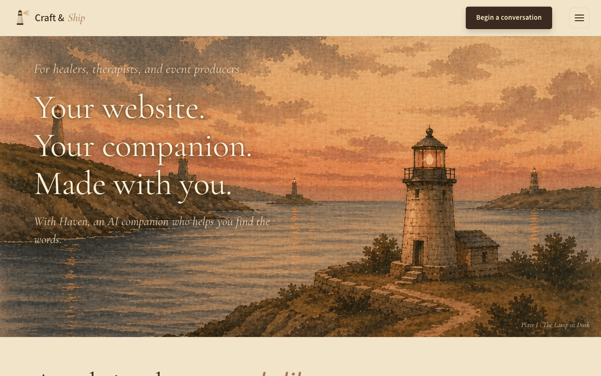
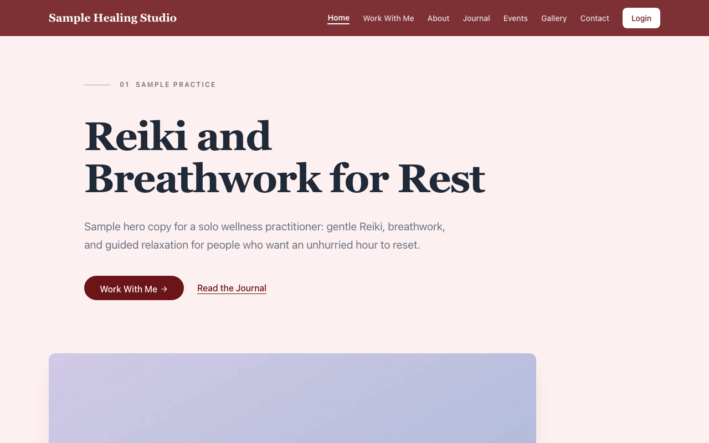
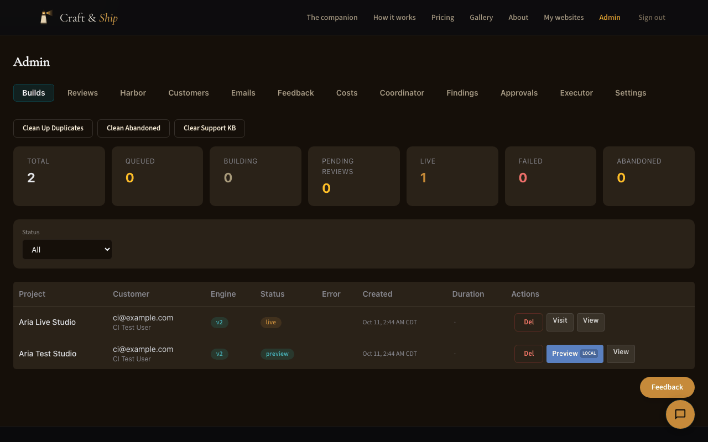

# Craft & Ship

[](https://github.com/aqlong/craftandship/actions/workflows/test.yml)
[](LICENSE)

Craft & Ship turned a conversation into a deployed website for healers, therapists and event producers. A visitor talked to an AI companion, a model extracted a structured spec from the conversation, code with no model in it composed a complete Express, EJS and Postgres site from that spec, a worker deployed it to its own Railway project, and a review step decided whether it could be marked live. It ran in production from March to July 2026. Real customers used it and gave feedback; none had become a paying subscriber when I wound it down.

I built it as the director of an AI coding agent, which wrote the code. I chose what to build and for whom, decided how much to automate, and made the agent prove its work. [How I built this](#how-i-built-this) says what that covered and what it did not.





**Read this with:**

- **Archived.** Nothing is deployed from this repository and it is not maintained. It is published so the engineering can be read, run locally and judged, limits included.
- **Not a snapshot of production.** A six-round adversarial review I ran after the wind-down changed the code, in places substantially. [What ran in production, and what the review changed](docs/WHAT_RAN_AND_WHAT_CHANGED.md) keeps the two apart.
- **A short public history.** The working history is private because it contains customer data. The first commit is the clean export; the commits after it are a portfolio pass the agent made at my direction and merged through [pull requests](https://github.com/aqlong/craftandship/pulls?q=is%3Apr+is%3Amerged).

## How I built this

I'm Ocean Longnion ([LinkedIn](https://www.linkedin.com/in/aaronlongnion)). I have 26 years of building software behind me, and today I design and direct AI-powered engineering workflows in enterprise software. On Craft & Ship I chose not to write the code by hand. An AI coding agent (Claude Code) wrote it, and my work was the judgment around it:

- **What to build, and for whom.** I chose the audience and kept simplifying toward it. In April 2026 the product became one companion, one subscription and one price, sliding from $39 to $19 a month.
- **When to take the model out.** When model-written apps kept coming back with the same classes of bug, I removed the model from the build path entirely (the v2 engine, decided 20 April 2026).
- **How much to automate.** Early on I reviewed much of the agent's code myself, and found it accurate and trustworthy as long as I had it review and revise its own work several times. That became the rule, and autonomy grew as it was earned: self-healing, and in June 2026 an automated review mode. The limits came after a background agent with write access deleted production in April 2026.
- **Proof, not claims.** I had the agent review, test and audit its own work throughout (code, security, accessibility, UX), and before publishing I ran six adversarial review rounds with fresh-context reviewers.
- **Taste.** Once the agent's code had earned that trust, I reviewed outcomes in the browser more than diffs: how it looked, how simple it was for its users, how the flow felt. When the interface looked AI-made, I redesigned the graphics and UI with Claude Design for the spa and wellness community, and had real customers give feedback on it.
- **The rules.** I had the agent analyze how I worked with it and what the code needed, then write and maintain its own working agreement, [CLAUDE.md](CLAUDE.md).

[docs/DECISIONS.md](docs/DECISIONS.md) records these calls and what each one cost.

What I did not do: review every diff, or write the planning documents (the agent drafted most of them). The private history that would show each change being proposed and accepted is not published. "Senior Web Craftsman", on the product's own pages, was the studio's brand title for me, not an engineering role.

## What is in here

| Path | What it is |
|---|---|
| [web/](web/src/app.ts) | The customer site, the companion ("Haven"; the product's vocabulary is in the [glossary](docs/GLOSSARY.md)), admin, and an ops API. TypeScript, Express, EJS, raw parameterized SQL on Postgres. |
| [compose/](compose/build.py) | The v2 build engine: a spec in, a whole website out, with four stated exceptions to determinism (the build time, the build day, the raster brand assets and the external-link lint's reports; [ARCHITECTURE.md](ARCHITECTURE.md#v2-engine-compose)). No model call in the build path. |
| [cli/](cli/README.md) | The v1 build engine, kept as legacy: a model wrote each app and 117 post-processors repaired the output. Not all of it is legacy: the worker imports [cli/deploy.py](cli/deploy.py) (the Railway deploy and its health checks) for both engines. |
| [queue/](queue/worker_pg.py) | The build worker. Postgres is the queue. |
| [coordinator/](coordinator/tick.py), [monitor/](monitor/ping.py), [ops/](ops/agent.py) | Budget-gated automation (mostly rule-based checks), health checks, backups. |
| [scripts/](scripts/cas-roadmap-loop.sh), [.githooks/](.githooks/pre-push), [.github/](.github/workflows/test.yml) | Hooks, lint gates, CI, and an unattended roadmap executor that ships disabled. |
| [docs/](docs/README.md) | Design notes, plans and runbooks. Mostly dated; the code outranks them. |

[ARCHITECTURE.md](ARCHITECTURE.md) has the diagrams, the build lifecycle and the trade-offs. [docs/THREAT_MODEL.md](docs/THREAT_MODEL.md) has the controls, each with its file and test, and [docs/KNOWN_LIMITATIONS.md](docs/KNOWN_LIMITATIONS.md) a long list of what they do not cover. [docs/GLOSSARY.md](docs/GLOSSARY.md) explains the product's vocabulary (Harbor, Haven, keeper, lamp).

## Start with these files

Much of the hardening came from the adversarial review I ran after the wind-down, so each item says whether it ran in production or came from that review.

1. [compose/build.py](compose/build.py), at [`_spec_safety_errors`](compose/build.py#L857) and [`_safe_output_path`](compose/build.py#L11902): a code generator that treats its input as hostile, and [compose/tests/test_spec_hardening.py](compose/tests/test_spec_hardening.py), which feeds it hostile specs and compiles what comes out. *Added in review; as it ran, the engine trusted its spec.*
2. [queue/worker_pg.py](queue/worker_pg.py), at [`_claim_next_job`](queue/worker_pg.py#L615), [`_set_status`](queue/worker_pg.py#L1286) and [`_fail_build`](queue/worker_pg.py#L5728): Postgres as a job queue and a status machine made of guarded `UPDATE` statements. [tests/test_worker_pg_realdb.py](tests/test_worker_pg_realdb.py) runs that SQL on a real database. *The queue ran in production; the forward-only status machine, the attempt token and the real-database tests were added in review.*
3. [web/src/middleware/auth.ts](web/src/middleware/auth.ts): session secret resolution, CSRF, the cross-origin write guard, and the single definition of "admin". *The CSRF token ran in production; the other three were added in review.*
4. [web/src/companion/runtime.ts](web/src/companion/runtime.ts): one conversation turn, in the order that matters: a local crisis scan, cost caps, an input rail, the model call, an output rail. *The rails and the per-person cap ran in production; putting the crisis scan ahead of everything else, and the shared cap, were added in review.* The scan is a list of regular expressions, not a clinical safeguard. Measured only on phrasings a language model wrote, none from real conversations: 39 of 40 plain disclosures in a set held back until the patterns were final, and 79% and 70% of two earlier sets, the second written to be indirect ([measured limits](docs/KNOWN_LIMITATIONS.md#harbor-companion)).
5. [coordinator/actuators.py](coordinator/actuators.py): the permission table that automation has to act through. *The table ran in production; the review made it the path for every write, send and model call of the coordinator's agents (the legacy ops agent, which runs only when the coordinator is off, has no permission table) and made it fail closed.*
6. [compose/data/](compose/data/archetypes.json), the decision files the v2 engine composes sites from. *As they ran, apart from comments and sample names.* The decision record for replacing v1 is [docs/internals/CAS_V2_STATIC_COMPOSE_PLAN.md](docs/internals/CAS_V2_STATIC_COMPOSE_PLAN.md); [docs/internals/MW_BUG_RECURRENCE_RCA.md](docs/internals/MW_BUG_RECURRENCE_RCA.md) documents the recurring v1 bugs.
7. [CLAUDE.md](CLAUDE.md): a public edition of the working agreement the coding agent operated under. *The behavioral rules are close to the original; the reference sections were rewritten for this release.*

For the worst code instead, [ARCHITECTURE.md](ARCHITECTURE.md#where-the-bodies-are-buried) lists it with line counts.

## What went wrong, plainly

These defects were in the code while it served customers. The pre-release review found them and this tree fixes them; [docs/PRE_RELEASE_REVIEW.md](docs/PRE_RELEASE_REVIEW.md) lists the most significant ones, with the fix and the test for each.

- The forgot-password page showed the one-time reset link to whoever submitted the form.
- A placeholder session secret was accepted in production.
- The companion's prompt told people their notes were encrypted and held to a therapist's standard of confidentiality. Neither was true. The prompt now forbids both claims; no output check enforces that.
- Someone could register another person's address first and keep access after that person verified it.
- The webhook that charged a trial visitor also locked them out of the site they had paid for.

### Operations

- The production hosting project was deleted twice in one day in April 2026, once by a background agent that had write access ([the recovery write-up](docs/RAILWAY_DISASTER_RECOVERY.md)).

These are true of the design, fixes or not:

- **A preview is not private.** It is a public address with no access control, and the generated site allows crawling from its first deploy.
- **"Live" is a status in a database.** Approval changes nothing on the deployed site.
- **Review was not always a person.** The product promised a human review of every site; an automated review mode was added in June 2026, and the repository does not record which sites took which path.

## Quickstart

About five minutes. You need Node 24 (what CI runs, and what `.nvmrc` and the `engines` field in `web/package.json` declare; `npm ci` warns on an older Node) and Postgres, from Docker or installed locally. No API keys are needed to boot the app and browse it.

**Option A: Postgres from Docker**

```bash
git clone https://github.com/aqlong/craftandship.git
cd craftandship
docker compose up -d --wait          # Postgres 16 on 127.0.0.1:5432
cp web/.env.example web/.env
cd web
npm ci
npm run build
npm start                            # http://localhost:4000, runs in the foreground
```

**Option B: a Postgres you already run locally**

```bash
git clone https://github.com/aqlong/craftandship.git
cd craftandship
createdb craftandship_web
cp web/.env.example web/.env
# in web/.env, replace the whole DATABASE_URL line (see below)
cd web
npm ci
npm run build
npm start                            # http://localhost:4000, runs in the foreground
```

In Option B, replace the whole `DATABASE_URL` line in `web/.env` with `DATABASE_URL=postgresql://localhost:5432/craftandship_web`. The template's `cas:cas` user exists only in the Docker database of Option A, so it fails on a plain Homebrew install. Without a user in the URL, the Node driver takes the role from the `USER` environment variable, which is the superuser a Homebrew install creates for you. Option A needs no edit.

The schema is applied at boot. On 18 October 2026 `npm audit` reported no advisories, development packages included. The server warns that `SESSION_SECRET` is still the placeholder and uses a random secret for that process, so logins end when it restarts. To use another port, set `PORT` in `web/.env`.

What to try, from a second terminal or a browser:

- `http://localhost:4000/health` answers `{"status":"ok", ...}` with `"db":"connected"`.
- The public site at `/` and the companion page at `/lighthouse/table`.
- **Sign up at `/signup`.** With no mail provider, the server prints the verification link to its console (`[dev] Email is not configured. Verification link: ...`). Open it in the browser you signed up in: you land on the companion page, logged in.
- **Admin pages:** the example environment sets `ADMIN_EMAIL=admin@example.com`. Sign up with that address and open `/admin/builds`. To use your own account instead, set `ADMIN_EMAIL` in `web/.env` to its address (lower case), restart, and log in again.



- **Chat needs your own key.** Without `ANTHROPIC_API_KEY`, a chat turn that reaches the model answers HTTP 503 with a message that begins "The assistant is not configured on this server". A crisis message is still answered, because the server answers it itself. [CLAUDE.md](CLAUDE.md#running-the-web-app-locally) says what a build request answers without a key.

The build worker, the deploy step and payments need Railway and Stripe accounts and are not part of the quickstart.

## Tests

Three suites execute real behavior and are the ones to read:

- [compose/tests/test_spec_hardening.py](compose/tests/test_spec_hardening.py) builds sites from hostile specs and compiles the output.
- [tests/test_worker_pg_realdb.py](tests/test_worker_pg_realdb.py) runs the worker's queue and status SQL on a real Postgres.
- [web/tests/unit/money-path.realdb.test.ts](web/tests/unit/money-path.realdb.test.ts) drives the publish, payment, signup and crisis routes on a real Postgres.

The rest is larger and says less: the web unit tests replace the database with mocks, and some tests assert on source text. [tests/README.md](tests/README.md) says which is which and why each group of tests skips.

Every block below starts from the repository root. Do the Quickstart first: the commands assume `cd web && npm ci` has run, the Python ones included (the engine's tests render templates with packages from `web/node_modules`, and some skip without it). The integration and browser blocks use `createdb` and URLs without a user, so they assume Option B.

```bash
# Web unit tests (no database needed)
cd web && npm test
```

```bash
# Python tests. Use Python 3.12 (what CI runs, what these results were measured on, and what
# .python-version names; `brew install python@3.12` or pyenv provides it). 3.13 does not work:
# the install fails on greenlet, which playwright==1.42.0 (pinned to match the worker image) requires.
# pytest creates and drops its own scratch databases (cas_test_scratch_*). It uses DATABASE_URL
# when that is set (and skips those tests if the URL names another machine); when it is unset,
# it uses the Postgres on localhost that the OS user can reach. Without one, those tests skip.
python3.12 -m venv .venv && . .venv/bin/activate
pip install -r requirements.worker.txt -r requirements-dev.txt
python3 -m pytest tests/ compose/tests -q
CAS_BUILD_ENGINE=v1 python3 -m pytest tests/ -q      # legacy v1 engine tests, skipped by default
```

On a Mac with a local Postgres 15, with other work running at the same time, the default run took about 17 minutes and the v1 run about 12 minutes. Times vary by machine.

```bash
# Web integration tests against a real Postgres (an empty database of their own).
# One of them runs the Python worker's cleanup, so point it at the virtualenv from the block above.
createdb craftandship_integration
cd web
CAS_SCHEMA_TEST_DATABASE_URL=postgresql://localhost:5432/craftandship_integration \
CAS_WORKER_PYTHON=../.venv/bin/python \
  npx vitest run --no-file-parallelism tests/unit/schema.idempotency.test.ts tests/unit/money-path.realdb.test.ts tests/unit/crisis-phrasing.realdb.test.ts
```

```bash
# Browser tests. They start their own server on port 4000, so stop `npm start` first
# (or add PORT=4412 to the exports below to use another port).
createdb craftandship_ui_test
cd web
npx playwright install chromium       # downloads a browser the first time
npm run build
export DATABASE_URL=postgresql://localhost:5432/craftandship_ui_test
export NODE_ENV=test SESSION_SECRET=local-ui-test-session-secret CAS_HARBOR_ENABLED=true
export DEV_TEST_EMAIL=ui@example.com DEV_TEST_PASSWORD=ui-test-password-123
export CAS_A11Y_DEV_TRIAL=a11c0de0-0000-4000-8000-00000000d2ec
export CAS_A11Y_LAMP_BUILD_ID=a11c0de0-0000-4000-8000-00000000a11c
node tests/ui/seed-test-db.js && npm run test:ui
```

<!-- results:start -->
Measured on this commit on macOS with Node 25 and Python 3.12 (CI runs Node 24 and Python 3.12 on Linux). The three suites that execute real behavior first:

| Suite | Result |
|---|---|
| Hostile specs through the build engine ([test_spec_hardening.py](compose/tests/test_spec_hardening.py)) | 305 passed |
| Worker SQL on a real Postgres ([test_worker_pg_realdb.py](tests/test_worker_pg_realdb.py), [test_worker_lifecycle_realdb.py](tests/test_worker_lifecycle_realdb.py)) | 180 passed |
| Web integration on a real Postgres (the third block above) | 449 passed |

The first two rows are `python3 -m pytest` on the files they name, from the repository root. And the full runs (the web unit run leaves out its real-Postgres files, and the two Python runs differ in scope):

| Suite | Result |
|---|---|
| Web unit (Vitest, database mocked) | 131 files passed, 4 skipped; 4297 tests passed, 189 skipped |
| Python, default | 8276 passed, 119 skipped, 4 xfailed |
| Python, v1 mode | 7635 passed, 25 skipped, 6 xfailed |
| Browser (Playwright) | 45 passed, 8 skipped |

Why tests skip ([tests/README.md](tests/README.md) has the detail):

- **Web unit:** the skipped tests are the real-Postgres ones of the integration row, which need a database to be named.
- **Python, default:** the tests that boot a generated site need a sample site built first (two commands; CI runs them), and one end-to-end module is opt-in.
- **Browser:** the skipped specs need fixtures the block above does not set (an admin login, a reset token, and the variables of the keyboard and screen-reader specs).

Statement coverage of the web app under the unit suite is 88% (85% of branches), measured with the database mocked (`cd web && npx vitest run --coverage`); the two files that only start the process (`src/server.ts`, `src/db/index.ts`) are left out of the denominator.
<!-- results:end -->

CI ([test.yml](.github/workflows/test.yml)) runs all of the above on Linux, plus a job that performs Option A on a clean runner and requests the home page, a job that builds the worker's Docker image and checks that its `pg_dump` can dump the database version the platform provisions, a gitleaks scan, and an advisory dependency audit. CI's first run on the release commit (`6144c8f`, 12 October 2026) passed all seven jobs ([the run](https://github.com/aqlong/craftandship/actions/runs/38287911118)). That includes the worker image: it was built and its `pg_dump` checked, though it was never run as a worker. [The review](docs/PRE_RELEASE_REVIEW.md) says what else was not run.

## How this release was made

AI agents prepared this release under my direction: the removal of private data, the review rounds, the fixes and the documentation, this file included. [docs/PRE_RELEASE_REVIEW.md](docs/PRE_RELEASE_REVIEW.md) describes that process and what it did not verify. [CLAUDE.md](CLAUDE.md) is the public edition of the agent's working agreement; Claude Code loads it when the repository is opened in it. No slash commands ship, and no hooks run, because `.claude/` holds only the hook configuration as an example file (`settings.example.json`).

## License

Code is released under the [MIT License](LICENSE). The Craft & Ship and Medicine Waves names, logos and artwork in `web/public/` and `cli/assets/` are not covered by it and may not be reused. Medicine Waves is the author's event brand, whose site was the reference build for the test fixtures. Third-party sources and the scope of the brand notice are listed in [THIRD_PARTY_NOTICES.md](THIRD_PARTY_NOTICES.md). See also [CONTRIBUTING.md](CONTRIBUTING.md).
