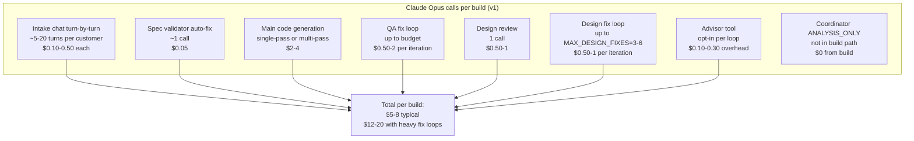
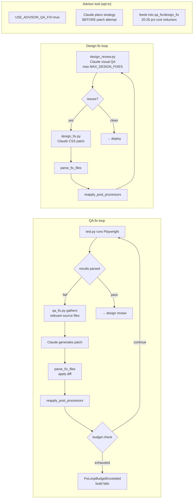
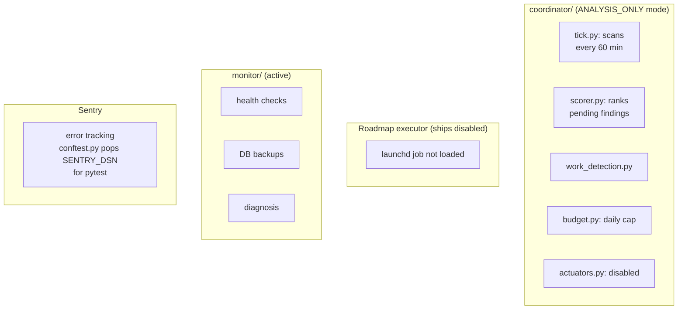
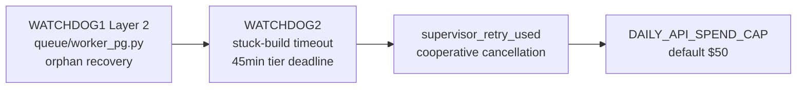

# CAS v1 build pipeline: visual reference

> Historical document from April 2026; the system is no longer developed and the site is still online.

**Tag:** `v1-beta-frozen` (a git tag in the original development
history; not carried into this export). This is the current-state
architecture (frozen 2026-04-21). All future pipeline work happens in v2 (static
compose; see [CAS_V2_ARCHITECTURE_VISUAL.md](CAS_V2_ARCHITECTURE_VISUAL.md)).

## Graphic visuals (open these first)

- **One-page poster:** [cas_v1_pipeline.png](cas_v1_pipeline.png)
- **Interactive HTML (hoverable, scalable):** [cas_v1_pipeline.html](cas_v1_pipeline.html)

The Mermaid diagrams below are the same content in a code-viewable
form for embedded reference; the PNG + HTML are the canonical
graphics.

Use this doc to:
- Understand the LLM-centric v1 build pipeline end-to-end.
- See exactly where every post-processor, fix loop, and LLM call
  lives so we can map each concern to a v2 widget/decision-file/
  template equivalent.
- Identify what stays (intake, Claude-for-copy) vs. what becomes
  static (all 117 post-processors, QA fixer, design fixer, advisor).

---

## Top-level flow

```mermaid
flowchart LR
    subgraph Customer["Customer"]
      C1[Describe app on<br/>craftandship.io /try]
    end

    subgraph Web["Web app (web/)"]
      W1[Chat intake<br/>Claude Opus]
      W2[Anon draft → signup<br/>+ email verify]
      W3[Payment<br/>Stripe or BYPASS]
      W4[Spec saved to DB<br/>builds.spec JSONB]
      W5[INSERT build row<br/>status=queued]
    end

    subgraph Queue["Worker (queue/worker_pg.py)"]
      Q1[Poll builds<br/>FOR UPDATE SKIP LOCKED]
      Q2[Dispatch to build_app]
    end

    subgraph Pipeline["cli/build.py build_app"]
      P1[load_and_validate spec]
      P2[Generate code<br/>Claude Opus single or multi-pass]
      P3[117 post-processors<br/>DAG-ordered]
      P4[Write files to<br/>builds/<app>/]
    end

    subgraph QA["QA + Design loops"]
      QA1[test.py<br/>Playwright E2E]
      QA2[qa_fix.py<br/>Claude re-patches<br/>up to budget]
      DR1[design_review.py<br/>Claude visual QA]
      DR2[design_fix.py<br/>Claude CSS fixes<br/>up to MAX_DESIGN_FIXES]
    end

    subgraph Deploy["deploy.py"]
      D1[Railway API<br/>projectCreate +<br/>serviceCreate]
      D2[git push to<br/>Railway remote]
      D3[Health check wait]
      D4[preview_url written<br/>builds.status=preview]
    end

    subgraph SE["SE Review Gate"]
      SE1[send_review_pending email]
      SE2[Founder visits<br/>/admin/reviews]
      SE3[Approve →<br/>send_review_ready<br/>status=live]
    end

    C1 --> W1 --> W2 --> W3 --> W4 --> W5 --> Q1 --> Q2
    Q2 --> P1 --> P2 --> P3 --> P4 --> QA1
    QA1 -- fail --> QA2 --> P3
    QA1 -- pass --> DR1
    DR1 -- issues --> DR2 --> P3
    DR1 -- clean --> D1 --> D2 --> D3 --> D4 --> SE1 --> SE2 --> SE3
```

---

## Where Claude is called today (the cost + variance sources)

**v2 delta:** only A (intake) and a narrower version of the copy
drafting inside A survive. B, C, D, E, F, G all disappear or become
deterministic.

---

## Post-processor phases (the 117 registered)

These all live in `cli/build.py` + `cli/pipeline.py` DAG. Phase
metadata `@processor(after=..., phase=('build', 'reapply'))`.

```mermaid
flowchart TD
    start([files from Claude generation])

    subgraph Phase1["1. Validation + schema normalization"]
      V1[_validate_spec_shape]
      V2[_normalize_password_column]
      V3[_verify_schema_column_references]
      V4[_scrub_bcrypt_from_seed<br/>SEC-1]
    end

    subgraph Phase2["2. Dependencies + security"]
      D1[_ensure_package_deps<br/>REQUIRED_DEPS baseline]
      D2[FORCE_UPGRADE_DEPS<br/>multer ^2.1.1, bcrypt ^6]
      D3[_ensure_railwayignore]
      D4[_ensure_resilient_migrate]
    end

    subgraph Phase3["3. Layout + design shell"]
      L1[_ensure_layout_html_skeleton]
      L2[_ensure_color_consistency]
      L3[_align_secondary_palette_to_spec]
      L4[_ensure_accent_color_variety]
      L5[_ensure_nav_brand_element]
      L6[_fix_nav_brand_contrast_and_dedupe]
      L7[Google Fonts / glass nav / etc.]
    end

    subgraph Phase4["4. Admin console + CRUD scaffolding"]
      A1[_ensure_admin_slug_mount]
      A2[_ensure_admin_model_handlers]
      A3[_enforce_admin_view_path_convention]
      A4[_rewrite_admin_router_template_switch]
      A5[_fix_admin_crud_link_prefix]
      A6[_fix_admin_layout_nav_prefix]
      A7[_unify_admin_dashboard_handler]
      A8[_ensure_site_settings<br/>23-key superset]
    end

    subgraph Phase5["5. Widget emission (B+C)"]
      W1[_emit_widgets<br/>canonical admin CRUD]
      W2[_ensure_crud_forms_complete]
      W3[_ensure_upload_form_ui<br/>drag-drop zones]
    end

    subgraph Phase6["6. Seeds + content binding"]
      S1[_ensure_minimum_seed_rows]
      S2[_ensure_settings_in_views]
      S3[_ensure_hero_settings_binding]
      S4[_ensure_contact_email]
    end

    subgraph Phase7["7. Auth + middleware"]
      M1[_ensure_magic_link_auth]
      M2[_ensure_magic_link_hash]
      M3[_ensure_csrf_import]
      M4[_ensure_settings_middleware_contract]
    end

    subgraph Phase8["8. UX/polish fixes"]
      U1[_fix_delete_button_styling]
      U2[_ensure_button_design_system]
      U3[_ensure_mobile_menu_close]
      U4[_ensure_skip_to_content]
      U5[_scrub_em_dashes_in_ejs]
      U6[_strip_dead_signup_links]
    end

    subgraph Phase9["9. Performance + PWA"]
      X1[_ensure_compression]
      X2[_ensure_static_caching]
      X3[_ensure_lazy_loading]
      X4[_ensure_dynamic_canonical]
      X5[sitemap.xml + service worker]
    end

    subgraph Phase10["10. Contract verification (last)"]
      Z1[_verify_template_middleware_contract]
      Z2[contracts/admin_crud.py]
      Z3[contracts/layout.py]
    end

    finish([write files to disk<br/>then QA phase])

    start --> Phase1 --> Phase2 --> Phase3 --> Phase4 --> Phase5
    Phase5 --> Phase6 --> Phase7 --> Phase8 --> Phase9 --> Phase10 --> finish
```

**v2 delta:** Phases 1–10 collapse into a single deterministic
"compose" step. The decision files + widget registry encode every
invariant that each post-processor currently patches up. Post-
processors are regressions patched on Claude's variance; widgets
emit correct output at build time.

---

## Fix loops in detail (the expensive variance-handling)

**v2 delta:** entire QA + design fix loops disappear. Composition
is deterministic; there's no variance to patch. A narrower smoke-
test still runs post-deploy (verify it booted), but no AI "fixer"
phase.

---

## Self-healing + monitoring (parallel systems, not in build path)

These run CONTINUOUSLY; they watch the prod deployment. Currently
all either paused, ANALYSIS_ONLY, or heavily gated because
historical incidents proved them too aggressive.

**v2 delta:** monitor + Sentry stay. Coordinator's role shrinks
(v2 has far fewer defect classes to triage). Executor stays
stopped. The whole "self-healing" investment disappears alongside
the variance it was built to heal.

---

## Watchdogs + supervisors

**v2 delta:** watchdogs become near-vestigial. Sub-2-min deterministic
builds rarely need timeout enforcement.

---

## Where each v1 concern maps to v2

| v1 concern | v2 equivalent |
|---|---|
| Intake chat (Claude Opus) | **Unchanged**; intake stays AI-powered for real-time decisions |
| Spec validator | Still exists but much narrower (just structural checks) |
| Main code generation (Claude) | **Replaced** by `compose/build.py` widget composition |
| 117 post-processors | **Replaced** by well-tested widgets emitting correct output |
| QA fix loop | **Removed**: composition is deterministic |
| Design review + fix loop | **Removed**; palette/fonts/layouts are curated choices, not LLM-decided |
| Advisor tool | **Removed** |
| reapply_post_processors | **Removed**: no generator output to reapply anything to |
| SE review gate | **Unchanged**: human review stays load-bearing |
| Coordinator | Scaled down; less variance to triage |
| Copy drafting (tagline, about, blog posts, testimonials) | **Narrow Claude API call** for copy drafting; cheap (Haiku-eligible) |
| Palette / font / layout suggestions | **Curated JSON** in `compose/data/` + AI suggests from curated set |

---

## Per-build resource envelope (v1 measured vs v2 target)

| Resource | v1 (measured) | v2 (target) | Delta |
|---|---|---|---|
| Claude API spend | $5–8 typical, $12–20 with heavy fix loops | $0.05–0.30 | ~100× |
| Wall time | 12–15 min typical | <2 min | ~7× |
| Defects/build (regressions Claude introduces) | 3–8 | <1 | 3–8× |
| Hot-patches required post-build | 1–3 common | 0 expected | - |
| Cached components reused across customers | 0 | ~40–60 widgets | - |
| Unit-test surface | post-processor tests (4242) | widget tests (~95% coverage target) | Widgets > post-processors |
| Regression surface | LLM emission variance | JSON decision file edits | Near-zero in v2 |

---

## The explicit v1 → v2 transition plan

See [`CAS_V2_STATIC_COMPOSE_PLAN.md`](CAS_V2_STATIC_COMPOSE_PLAN.md)
for the 7-phase plan. Phase 0 (freeze v1 as beta) is done as of
2026-04-21, tag `v1-beta-frozen`. v1 code stays in current
top-level dirs (`cli/`, `queue/`, `coordinator/`, `monitor/`) and
is reachable for reference via `CAS_BUILD_ENGINE=v1` worker env flag
after v2 lands in `compose/`.
