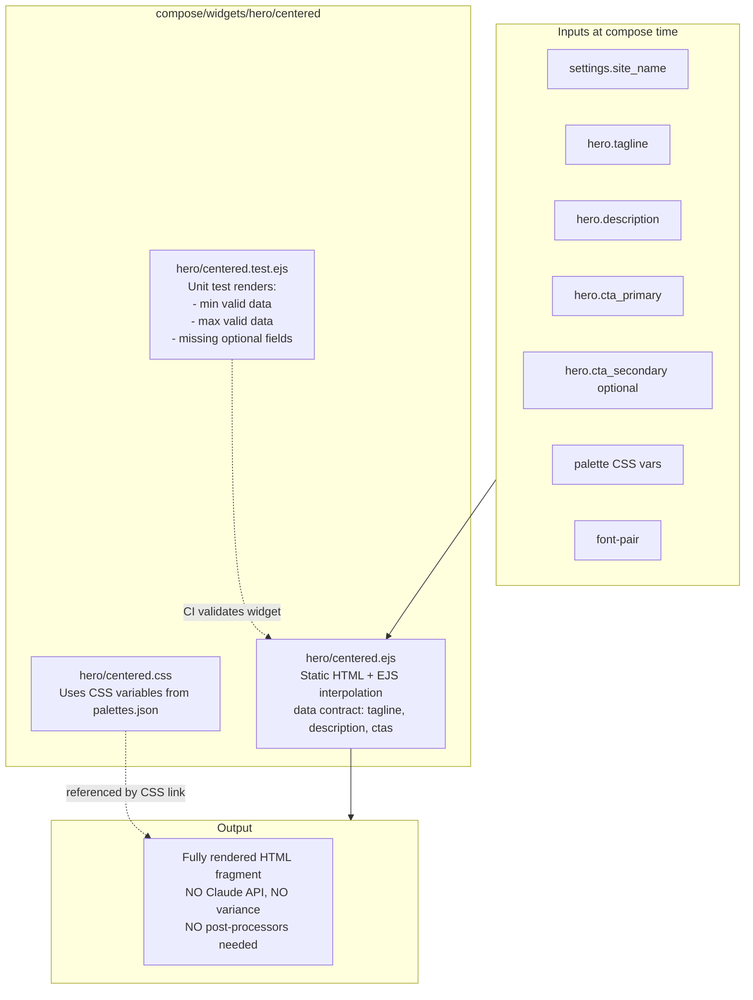
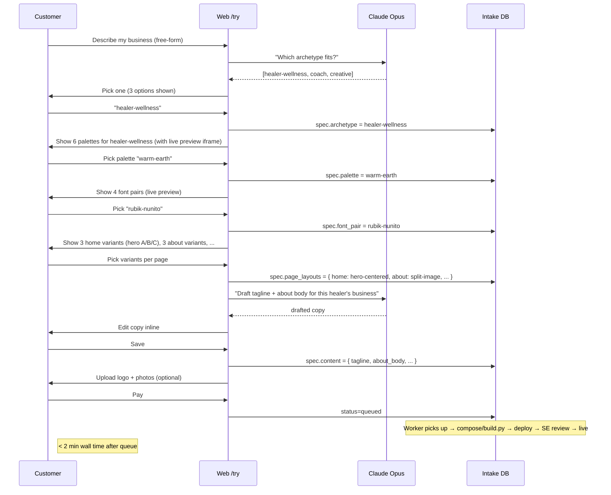

# CAS v2: static-compose architecture (general proposal)

> Historical document from April 2026; the system is no longer developed and the site is still online.

**Status:** GENERAL PROPOSAL. This document is the initial shape
of v2 architecture that will be refined during the Phase 1 audit
of 20 real small-biz webapps (see `CAS_V2_STATIC_COMPOSE_PLAN.md`).

## Graphic visuals (open these first)

- **One-page poster:** [cas_v2_architecture.png](cas_v2_architecture.png)
- **Interactive HTML (hoverable, scalable):** [cas_v2_architecture.html](cas_v2_architecture.html)

The Mermaid diagrams below are the same content in a code-viewable
form; the PNG + HTML are the canonical graphics.
Details that depend on audit findings (exact archetype list, widget
inventory, decision-file schemas) are marked with `[FILL DURING
PHASE 1]` and should NOT be frozen before audit completion.

See [CAS_V1_PIPELINE_VISUAL.md](CAS_V1_PIPELINE_VISUAL.md) for the
current-state contrast.

---

## Architectural pillars (set in stone before audit)

1. **No Claude calls in the build path.** Claude stays in the
   intake conversation + copy drafting only.
2. **Three-layer static system:** decision files + widget registry
   + templates.
3. **Curated choice UI** for every creative decision: archetype,
   palette, font pair, page-layout variant, imagery.
4. **Worker env flag** `CAS_BUILD_ENGINE=v1|v2` for per-customer
   rollout during transition.
5. **v1 codepaths preserved** in `cli/`, `queue/`, etc. as fallback.
   v2 lives in `compose/`.

---

## Top-level flow

```mermaid
flowchart LR
    subgraph Customer["Customer"]
      C1[Describe app on<br/>craftandship.io /try]
    end

    subgraph Intake["Intake (web/)"]
      I1[Chat intake<br/>Claude Opus<br/>real-time decisions]
      I2[Archetype detection<br/>Claude suggests 1-3<br/>customer picks 1]
      I3[Palette picker<br/>4-8 curated per archetype]
      I4[Font-pair picker<br/>3-5 curated pairs]
      I5[Page layout picker<br/>2-3 variants per page type]
      I6[Imagery<br/>curated stock + optional upload]
      I7[Copy drafting<br/>Claude writes tagline<br/>about, posts<br/>customer edits inline]
      I8[Payment<br/>Stripe]
      I9[Spec written to DB<br/>structured v2 shape]
    end

    subgraph Queue["Worker (queue/worker_pg.py)"]
      Q1[Poll builds]
      Q2[Dispatch to compose.build_app]
    end

    subgraph Compose["compose/build.py: DETERMINISTIC"]
      CO1[Validate v2 spec]
      CO2[Resolve archetype bundle]
      CO3[Resolve palette CSS vars]
      CO4[Resolve font pair]
      CO5[Compose each page<br/>from widget layout variant]
      CO6[Inject content<br/>seed.sql from copy]
      CO7[Emit files<br/>schema + routes + views<br/>+ public assets]
    end

    subgraph Deploy["deploy.py (unchanged)"]
      D1[Railway API<br/>projectCreate + serviceCreate]
      D2[git push]
      D3[Health check wait]
      D4[preview_url → DB]
    end

    subgraph SE["SE Review Gate (unchanged)"]
      SE1[send_review_pending]
      SE2[Founder review]
      SE3[Approve → live]
    end

    C1 --> I1 --> I2 --> I3 --> I4 --> I5 --> I6 --> I7 --> I8 --> I9 --> Q1 --> Q2
    Q2 --> CO1 --> CO2 --> CO3 --> CO4 --> CO5 --> CO6 --> CO7 --> D1 --> D2 --> D3 --> D4 --> SE1 --> SE2 --> SE3
```

**No QA fix loop. No design fix loop. No advisor tool. No
reapply_post_processors, and no post-processor layer.** Each invariant
those systems patched up is now encoded in the widget itself.

---

## The three-layer decision system

```mermaid
flowchart TB
    subgraph DecisionLayer["compose/data/: DECISION FILES (JSON)"]
      DF1[archetypes.json<br/>~7-10 business archetypes<br/>each -> widget bundle + defaults]
      DF2[palettes.json<br/>20-30 curated palettes<br/>CSS variables]
      DF3[font-pairs.json<br/>15-20 curated Google Fonts pairs]
      DF4[page-layouts.json<br/>per page type x archetype<br/>ordered widget compositions]
      DF5[widget-registry.json<br/>widget -> file + data contract]
    end

    subgraph WidgetLayer["compose/widgets/: UI KIT (EJS + CSS)"]
      W1[Shell: nav, footer, mobile-menu, skip-to-content]
      W2[Hero: centered, split, video, carousel]
      W3[Grid: offerings, services, testimonials, gallery]
      W4[CTA: newsletter, inquiry, book-now]
      W5[Resource: list, detail, card, article]
      W6[Form: contact, login, magic-link, newsletter]
      W7[Admin: dashboard, CRUD, settings, image-upload]
      W8[Error: 404, 403, 500]
      W9[Utilities: date-format, etc.]
    end

    subgraph TemplateLayer["compose/templates/: PAGE SHAPES"]
      T1[home.ejs: slots widgets from page-layouts.json]
      T2[about.ejs]
      T3[services.ejs / work-with-me.ejs]
      T4[events.ejs, blog.ejs, contact.ejs, etc.]
      T5[admin/dashboard.ejs, admin/settings.ejs, admin/<slug>/*]
    end

    DF1 --> T1
    DF4 -->|which widgets<br/>in what order| T1
    DF2 -->|CSS vars| T1
    DF3 -->|Google Fonts link| T1
    DF5 -->|resolve widget file| W1 & W2 & W3 & W4 & W5 & W6 & W7 & W8 & W9
    W1 & W2 & W3 & W4 & W5 & W6 & W7 & W8 & W9 -->|render partial| T1
```

**Adding a new palette:** edit `palettes.json`. Zero code.
**Adding a new font pair:** edit `font-pairs.json`. Zero code.
**Adding a new archetype:** edit `archetypes.json` + maybe add 1-2
widgets for novel patterns. Small code.
**Adding a new widget variant:** create one EJS + CSS pair + update
registry. Small code.

---

## Anatomy of a single widget (example)

---

## Customer-facing intake flow (v2)

**Compare with v1:** customer gives a text description, Claude
generates the whole app, fix loops chase variance, and the customer
often gets something *different* than imagined because Claude's
interpretation drifts.

---

## Phase 1 audit will define:

All items marked `[FILL DURING PHASE 1]` below:

- **Exact archetype list.** Current working set: Healer/Wellness,
  Coach/Consultant, Local Service (plumber/electrician/massage/tax),
  Creator/Portfolio, Nonprofit, Retail, Professional Services.
  Phase 1 audit of 20 real sites will validate / refine.
- **Widget catalog.** Current estimate: ~40–60 widgets. Audit will
  list every distinct widget pattern observed across the 20 sites
  + their variation axes.
- **Data-model taxonomy.** What content types repeat: Service,
  Testimonial, Event, BlogPost, GalleryItem, ContactInquiry,
  NewsletterSubscriber, probably Product for retail. Exact field
  shapes determined by audit.
- **Per-archetype default bundles.** Each archetype's default page
  set, default widgets per page, default palette suggestions,
  default copy tone.
- **Widget data contracts.** Exact shape of `{data}` each widget
  consumes. Audit informs this.
- **Fill rates per archetype.** Palette count per archetype,
  font-pair count, layout-variants-per-page-type count. MVP
  target: enough variety that two customers in the same archetype
  don't produce visually-identical sites, even without adding
  custom CSS.

---

## What stays from v1

| v1 component | Role in v2 |
|---|---|
| `web/` (intake, dashboard, gallery, admin review) | Unchanged (intake flow gets richer choice UI) |
| `queue/worker_pg.py` | Unchanged (dispatches to `compose.build_app` when `CAS_BUILD_ENGINE=v2`) |
| `deploy.py` | Unchanged (Railway project + service creation) |
| SE Review Gate (`/admin/reviews`) | Unchanged; human review stays load-bearing |
| `monitor/` | Unchanged (still watches prod deployments) |
| Coordinator in ANALYSIS_ONLY | Smaller role (v2 has far fewer defects to triage) |
| Sentry integration | Unchanged |
| `cli/design_data.py` archetype detection | Reused in intake for archetype suggestions |
| Stock photo library | Reused as curated imagery source per archetype |

---

## What disappears in v2

| v1 component | Reason it disappears |
|---|---|
| `cli/build.py` main generation | Replaced by `compose/build.py` |
| 117 post-processors | Invariants baked into widgets |
| `qa_fix.py` + QA fix loop | No variance to chase; composition is deterministic |
| `design_review.py` + `design_fix.py` | Design choices are curated JSON, not LLM-decided |
| Advisor tool (`USE_ADVISOR_*`) | No more fix loops to optimize |
| `reapply_post_processors` | No post-processors to reapply |
| `cli/widgets/` (B+C phase 1 widget emitters) | Superseded by `compose/widgets/` |
| `cli/contracts/` | Widgets emit correct output by construction |
| Advisor Pydantic-shape mocks + test-build failures | Not a concern; no Pydantic SDK use in build path |

---

## Per-build resource envelope (v2 target vs v1 measured)

| Resource | v1 measured | v2 target | Delta |
|---|---|---|---|
| Claude API per build | $5–8 typical | $0.05–0.30 | ~100× |
| Wall time | 12–15 min | <2 min | ~7× |
| Regressions per build | 3–8 | <1 | 3–8× |
| Dev days per bug fix | 1–3 (pipeline change + rebuild cycle) | 10 min (JSON edit or widget tweak) | ~150× |
| Per-customer code churn | pipeline touches affect all customers | pipeline-isolated via widget; customers unaffected by others' fixes | - |

---

## Transition milestones (from plan)

Phase 0: freeze v1 as beta. **DONE 2026-04-21**, tag
`v1-beta-frozen` (a git tag in the original development history; not
carried into this export).

Phase 1: prior-art audit (planned deliverable: findings write-up
+ 20 per-site audits + refined archetype taxonomy + widget catalog).

Phase 2: decision files + widget registry.

Phase 3: widget library MVP.

Phase 4: compose pipeline (worker integration via
`CAS_BUILD_ENGINE` flag).

Phase 5: intake + choice UI redesign.

Phase 6: shadow validation against 5–10 real specs.

Phase 7: library growth + v1 sunset.

No wall-clock estimates are made.
